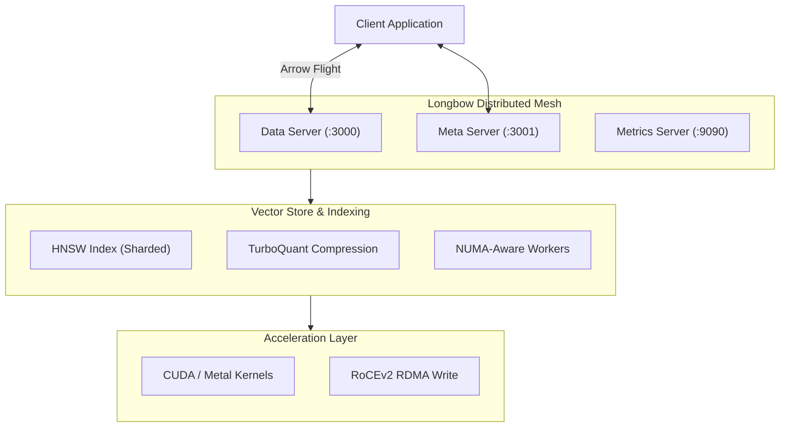

# Longbow Documentation

Longbow is a high-performance, distributed, and in-memory vector store implementing the Apache Arrow Flight protocol. It is engineered for low-latency similarity search, hybrid retrieval, and GraphRAG workloads at scale.

---

## Core Guides

### 1. [Quick Start & Deployment](deploy.md)

Get started with Longbow using Docker or Helm. Covers installation, environment configuration, CLI reference, limits, security, and troubleshooting.

### 2. [Unified Search & Discovery](vectorsearch.md)

Comprehensive guide to all Longbow search modes (including Flight `DoGet`/`DoAction`, REST v1 `/api/v1/*`, GraphQL, `longbow-cli`, Python SDK, and `bench-tool`):

- **Dense Vector Search (ANN / k-NN)**: HNSW vector similarity across 17 data types with SIMD/GPU/TPU acceleration and global scatter-gather (`LocalOnly=false`).
- **Vector Search by ID (`ByID`)**: O(1) similarity lookup from a stored vector ID (`search_by_id`, `/search/by-id`, `longbow-cli search -mode by-id`).
- **Filtered Search**: SIMD predicate evaluation (`filters`), complex boolean `filter_expr` AST, subqueries, and CTE pipelines.
- **Sparse / BM25 Keyword Search**: Pure keyword retrieval over inverted text indexes (`alpha=0.0` + `text_query`).
- **Advanced Full-Text Search**: Boolean AST (`AND`/`OR`/`NOT`), phrase matching, Damerau-Levenshtein fuzzy terms (`~N`), `<mark>` snippets, categorical facets, tunable BM25 (`k1`, `b`), and zero-result analytics (`AdvancedTextSearch`, `/text-search`, `longbow-cli text-search`).
- **Hybrid Search**: Dense HNSW + BM25 RRF/weighted blending with optional un-fused `raw_hybrid` results and GraphRAG blending (`/hybrid`).
- **Distance-Threshold Range Search**: Radius/thresholded HNSW search returning all matches within a distance bound (`range_search`, `/range-search`, GraphQL `rangeSearch`, `longbow-cli range-search`).
- **Temporal Search**: Point-in-time `as_of`, `range`, `sliding_window`, `sliding_window_time`, version history, and temporal aggregations (`/temporal-search`, `longbow-cli temporal-search`).
- **Geo-Spatial Search**: Haversine `radius`, bounding `box`, and geo+vector `hybrid` queries via Quadtree or Morton grid (`/geo-search`, `longbow-cli geo-search`).
- **Multi-Modal / Cross-Modal Search**: Text, image (PNG/JPEG), and audio (PCM16 WAV) joint embeddings and cross-modal retrieval (`MultiModalSearch`, `/multimodal-search`, `longbow-cli multimodal-search`).
- **Hybrid Vector-Graph Recommendation (`Recommend`)**: Multi-hop seed expansion blended with vector similarity (`recommend`, `/recommend`, `longbow-cli recommend`).
- **GraphRAG & Distributed Graph Expansion**: Spreading activation (`graph_alpha`/`graph_depth`), explicit triple traversal (`traverse-graph`), `GraphRAGExpand`, and cluster-wide `GlobalGraphRAG`.
- **Federated Cross-Collection Search**: Parallel k-NN across multiple collections or tag-routed collections fused via RRF (`federated_search`, `/api/v1/search/federated`, GraphQL `federatedSearch`, `longbow-cli federated-search`).
- **TurboQuant & Learned Index**: 2/4/8-bit compressed ANN search (`TurboQuant`) and runtime k-NN index auto-dispatch (`LearnedIndex`).
- **Companion Pipeline Actions**: Cross-encoder/hybrid reranking (`Rerank`), synonym/multi-query/HyDE query rewriting (`RewriteQuery`), and HNSW hop/score explainability (`ExplainSearch`, `DebugSearchPath`).

### 3. [High-Performance Indexing](indexing.md)

Tuning for scale and speed:

- **Quantization**: PQ, SQ8, BQ, and **TurboQuant** (2/4/8-bit).
- **Adaptive**: Automated Flat-to-HNSW migration for zero-config scaling.
- **Learned Index**: Runtime k-NN classifier for optimal index selection.
- **Memory**: GOGC Auto-tuning and slab-arena management.

### 4. [Hardware Acceleration & ML Inference](wasm_onnx.md)

Unleash hardware performance:

- **GPU/TPU**: CUDA (NVIDIA), Metal (Apple Silicon), and Google TPU (Ironwood).
- **Inference**: ONNX Runtime (native acceleration) and WASM (Wazero sandboxed portability).
- **Networking**: Zero-copy RDMA over RoCEv2.

### 5. [Systems Architecture](architecture.md)

Deep dive into Longbow's design:

- **Distributed Mesh**: Gossip-based membership and Consistent Hashing.
- **Storage**: WAL, Snapshots, S3/GCS offloading, and tiered storage.
- **Data Lifecycle**: Tombstones, compaction, TTL, LRU eviction.
- **Hardware**: CUDA, Metal, TPU, SIMD acceleration matrix.

### 6. [API Reference](api.md)

Technical specification for the Arrow Flight endpoints:

- **Data Plane**: DoPut ingestion, DoGet search, DoExchange sync.
- **Control Plane**: Global search, admin operations, GraphRAG actions.
- **Python SDK**: Zero-copy client with native Pandas/NumPy integration.

### 7. [Native Tensor Calculus Engine](tensor_engine.md)

General-purpose tensor calculus and scientific computing engine:

- **Einstein Summation**: Multi-tensor contraction chains.
- **Tensor Calculus**: Christoffel symbols, Riemann curvature, Ricci tensors.
- **Hardware**: AVX2 SIMD and NVIDIA CUDA/cuBLAS kernels.

### 8. [EMLGo Mathematical Engine](emlgo.md)

High-performance math backend:

- **Build-Tag Gated**: Compiled only with `-tags emlgo`.
- **Hardware Assembly**: AVX2, AVX-512, and ARM NEON fastmath primitives.
- **Tensor Acceleration**: 1.66x faster hyperbolic functions.
- **A/B Benchmarks**: Full performance evaluation across 17 datatypes.

---

## Reference

### 9. [Agent Memory](agentmemory.md)

AI agent memory patterns: hybrid search, temporal awareness, geo-spatial queries, and session management.

### 10. [Features & Competitive Landscape](features.md)

Feature checklist and competitive analysis vs FAISS, Milvus, Qdrant, and Pinecone.

### 11. [GraphRAG](graphrag.md)

Graph RAG dual-path architecture: Knowledge Graph edges and Spreading Activation.

### 12. [HNSW Tuning](hnsw.md)

HNSW parameter tradeoffs, memory breakdown, and concurrency safety.

### 13. [Development Guide](development.md)

Contributing, architecture overview, benchmarking, and test infrastructure.

### 14. [Prometheus Metrics](metrics.md)

Complete metrics reference for monitoring system health.

### 15. [Security & Compliance](security-compliance.md)

RBAC, API key lifecycle, row-level security, TLS/mTLS hot rotation, AES-256-GCM at-rest encryption, KMS/Vault, and SOC2/GDPR mappings.

### 16. [Serverless, Edge SDKs & WASM Client](edge-wasm.md)

Pure-Go WASM local HNSW index, offline-first conflict resolution, TypeScript Edge SDK (`sdk/edge-js`), and HTTP sync/search endpoints.

### 17. [Feature Parity Roadmap (Items 1–15)](roadmap.md)

End-to-end roadmap covering Managed Cloud multi-region replication, first-class REST/GraphQL APIs, RBAC, backup/PITR, streaming CDC, multi-modal pipelines, usage metering, sharding, encryption/mTLS, schemas, materialized views, advanced text search, and provenance.

---

## Architecture Overview

