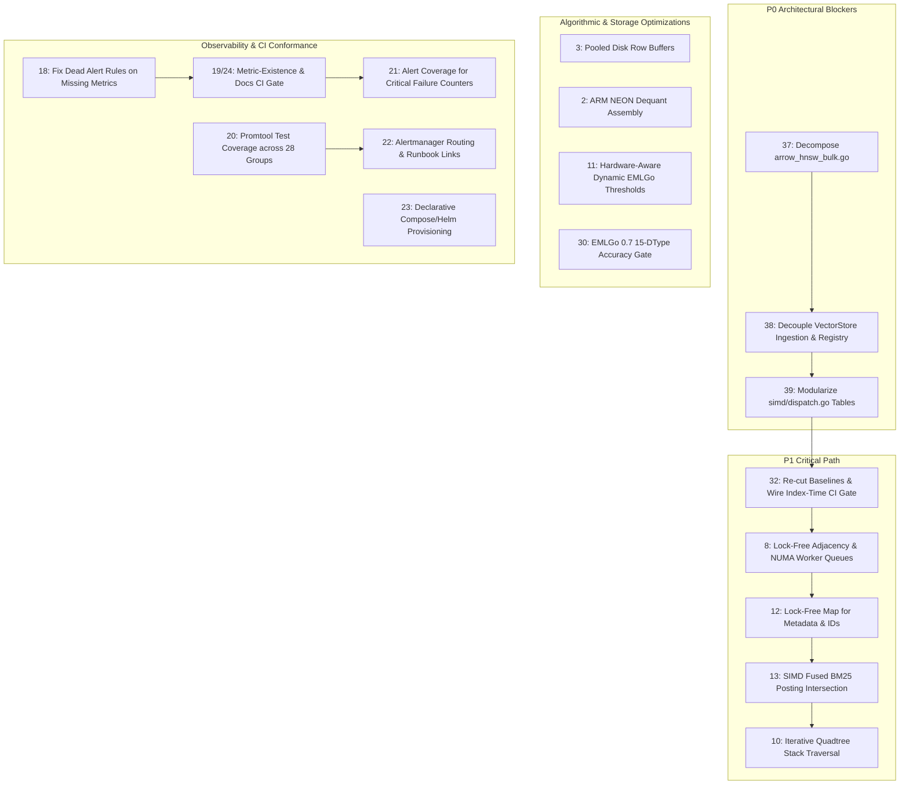

# Longbow Roadmap

**Last updated**: 2026-10-16  
**Status**: Active roadmap focusing on remaining performance, algorithmic scaling, and observability milestones. All completed historical items (Items 1, 4–7, 9, 14–17, 25–29, 31, 33–36) have been verified and removed to maintain execution clarity.

---

## 1. Top Immediate Priorities (P0 Blockers & P1 Critical Path)

| Pri | # | Item | Area | Impact / Rationale |
|:---|:---|:---|:---|:---|
| **P0** | **37** | **Decompose `arrow_hnsw_bulk.go` Graph Monolith** | Architecture / Index | 1,754-LOC file interweaving batch linking, Arrow column extraction, and graph repair. Split into cohesive sub-components. |
| **P0** | **38** | **Decouple `VectorStore` Ingestion Coordinator & Dataset Registry** | Architecture / Store | 163-file coordinator struct mixing NUMA pinning, queue workers, batch decoding, and dataset state. Extract worker pool and registry. |
| **P0** | **39** | **Modularize `simd/dispatch.go` Function Tables** | Architecture / SIMD | 1,512-LOC monolith with 150+ flat function pointers. Group into sub-dispatchers with layered inheritance. |
| **P1** | **32** | **Baseline Re-cut & Index-Time Regression CI Gate** | Performance / CI | Blocks safe PR merges. Implementation exists (`scripts/check_index_regression.py`); requires re-cutting baseline JSONs with deterministic seeds (post-Item 31) and wiring into `.github/workflows/benchmark-ab.yml`. |
| **P1** | **8** | **Lock-Free Adjacency Updates & NUMA Worker Queues** | Concurrency / Ingest | Mutex lock profiling shows 69.10% flat lock delay in `sync.(*Mutex).Unlock`, with `StartIndexingWorkers` contributing 53.8% cumulative lock delay. Migrate to generation-stamped CAS adjacency lists and sharded NUMA worker queues. |
| **P1** | **12** | **Lock-Free Concurrent Map for Metadata & ID Translation** | Concurrency / Memory | Copy-on-Write cloning in `MapRCU` triggers >1,200 MB of heap allocations during streaming ingestion batches due to repeated `make(map[K]V)` allocations. Replace with chunked Trie or lock-free hash map. |
| **P1** | **13** | **SIMD Fused BM25 Term Scoring & Posting List Intersection** | Sparse / Ranking | BM25 multi-term queries evaluate posting lists sequentially with map lookups. Vectorize posting list intersection using AVX-512 `VFMADD` instructions across contiguous document length arrays. |
| **P1** | **10** | **Iterative Stack Traversal for Geospatial Quadtree Queries** | Geospatial / Algorithmic | `(*Quadtree).queryBoxRecursive` and `SearchRadius` allocate temporary slices at each recursive quadrant subdivision (~1,985 MB cumulative allocations). Replace with iterative fixed-depth stack. |

---

## 2. P0 — Architectural God Module Blockers

### Item 37: Decompose `arrow_hnsw_bulk.go` & `arrow_hnsw.go` Graph Monolith
- **Status**: **OPEN**
- **Files**: `internal/store/index/arrow_hnsw_bulk.go`, `internal/store/index/arrow_hnsw.go`, `internal/store/index/bulk_linker.go`, `internal/store/index/bulk_column_reader.go`
- **State**: `arrow_hnsw_bulk.go` spans 1,754 LOC interweaving Arrow record batch column decoding, multi-pass graph linking, bidirectional neighbor repairs, and heuristic pruning.
- **Plan**: Split into `bulk_linker.go` (graph linking state machine), `bulk_column_reader.go` (Arrow record batch extraction), and `bulk_repair.go` (reachability and orphan healing).
- **Success Criteria**: Component file sizes under 800 LOC each; strict separation between Arrow data extraction and graph topology linking.

### Item 38: Decouple `VectorStore` Ingestion Coordinator & Dataset Registry
- **Status**: **OPEN**
- **Files**: `internal/store/store.go`, `internal/store/store_lifecycle.go`, `internal/store/store_ingest.go`, `internal/store/index_worker_pool.go`, `internal/store/dataset_registry.go`
- **State**: `VectorStore` is a 163-file coordinator struct mixing NUMA topology pinning, indexing worker goroutines, adaptive $ef$ adjustments, queue batching, and dataset map lookups.
- **Plan**: Extract `IndexWorkerPool` into `internal/store/index_worker_pool.go` and dataset mapping into `internal/store/dataset_registry.go`.
- **Success Criteria**: `store_lifecycle.go` reduced from 885 LOC to <300 LOC; clean lifecycle hooks for worker pools and dataset management.

### Item 39: Modularize `simd/dispatch.go` Function Tables
- **Status**: **OPEN**
- **Files**: `internal/simd/dispatch.go`, `internal/simd/dispatch_tables.go`
- **State**: `dispatch.go` spans 1,512 LOC with 150+ flat function pointers on `ImplementationDispatch` and repetitive tier-initialization blocks.
- **Plan**: Group function pointers into sub-dispatchers (`MetricDispatch`, `BatchDispatch`, `QuantDispatch`, `ConversionDispatch`) and implement table layering (base generic -> AVX2 -> AVX-512/AMX).
- **Success Criteria**: Zero overhead on hot-path kernel dispatches; initialization boilerplate reduced by >60%.

---

## 3. P1 — Core Performance & Hardware Acceleration

### Item 32: Per-Dtype Index-Time Regression Guard at 250k and 500k
- **Status**: **PARTIAL** (Evaluation script complete; baseline re-cut and CI workflow wiring pending)
- **Files**: `scripts/check_index_regression.py`, `.github/workflows/benchmark-ab.yml`, `benchmarks/baseline_*.json`
- **State**: The comparison script `scripts/check_index_regression.py` exists with lockable exit codes for paired index time and search QPS. However, Item 31 replaced static `--seed 42` with derived seeds per configuration (`LONGBOW_BENCH_SEED`), making historical baseline JSON files incompatible with fresh benchmark runs.
- **Plan**:
  1. Re-generate canonical baseline files (`benchmarks/baseline_*.json`) across 25k, 100k, and 250k scales using the new deterministic seed derivation.
  2. Integrate `scripts/check_index_regression.py` into `.github/workflows/benchmark-ab.yml` to enforce a ≤5% index-time regression gate on scheduled interleaved A/B runs.
- **Success Criteria**: Zero false-positive alerts on self-noise tests; automated CI cancellation on true index-time regressions ≥5%.

---

## 4. P2 — Algorithmic & Storage Optimizations

### Item 8: Lock-Free Adjacency Updates & NUMA-Local Index Worker Queueing
- **Status**: **OPEN**
- **Files**: `internal/store/index/flat_adjacency.go`, `internal/store/index/arrow_hnsw_bulk.go`, `internal/store/vector_store.go`
- **State**: Lock profiling (`mutex.pprof`) reveals 69.10% flat lock delay in `sync.(*Mutex).Unlock`, with `StartIndexingWorkers` contributing 53.8% cumulative lock delay during concurrent batch indexing.
- **Plan**: Migrate adjacency list mutations to generation-stamped lock-free atomic compare-and-swap (CAS), and shard incoming ingestion batches into NUMA-local worker queues.
- **Success Criteria**: Mutex contention during parallel ingest drops below 5%; index construction scales linearly across 16+ cores.

### Item 12: Lock-Free Concurrent Map for Metadata & ID Translation
- **Status**: **OPEN**
- **Files**: `internal/store/types/map_rcu.go`
- **State**: Copy-on-Write cloning in `MapRCU` triggers >1,200 MB of heap allocations during streaming ingestion batches due to repeated `make(map[K]V)` allocations.
- **Plan**: Replace `MapRCU` with a chunked Trie or lock-free concurrent hash map for VectorID ↔ Document ID mappings and string metadata.
- **Success Criteria**: Zero map reallocations on batch writes; significant reduction in GC pause durations during streaming ingestion.

### Item 13: SIMD Fused BM25 Term Scoring & Posting List Intersection
- **Status**: **OPEN**
- **Files**: `internal/store/index/bm25_inverted_index.go`, `internal/simd/dispatch.go`
- **State**: BM25 multi-term queries evaluate posting lists sequentially, looking up document lengths and term frequencies via Go map lookups.
- **Plan**: Implement vectorized posting list intersection using AVX-512 `VFMADD` instructions, scoring 16 candidate documents simultaneously from contiguous document length arrays.
- **Success Criteria**: 3x–5x throughput improvement in sparse and hybrid BM25 ranking.

### Item 10: Iterative Stack Traversal for Geospatial Quadtree Queries
- **Status**: **OPEN**
- **Files**: `internal/store/geo_index.go`
- **State**: `(*Quadtree).queryBoxRecursive` and `SearchRadius` allocate temporary slices at each recursive quadrant subdivision (~1,985 MB cumulative allocations).
- **Plan**: Replace recursive quadtree bounding box queries with an iterative traversal using a fixed-depth stack and reusable pre-allocated ID buffer in `SearchContext`.
- **Success Criteria**: Zero heap allocations during geospatial bounding box and radius queries; geo search QPS increases by 25%–40%.

### Item 3: Pooled Row Buffers in `DiskVectorStore`
- **Status**: **OPEN**
- **Files**: `internal/store/index/disk_vector_store.go`, `internal/store/index/buffer_pool.go`
- **State**: Non-vectorized disk scans allocate slice headers and temporary row buffers on every row extraction.
- **Plan**: Pool row buffers to eliminate transient allocations during disk traversals.
- **Success Criteria**: Zero-allocation row decoding in `DiskVectorStore`.

### Item 2: ARM NEON Dequant Kernel & Remaining Scalar SQ8 Fallbacks
- **Status**: **OPEN**
- **Files**: `internal/simd/dequant_other.go`, `internal/store/index/distance_dispatch.go`
- **State**: AVX2+FMA fused dequant-L2 kernels exist for AMD64, while ARM64 relies on scalar fallbacks.
- **Plan**: Implement native ARM NEON assembly for fused dequantization and L2 distance calculation.
- **Success Criteria**: ARM64 parity tests pass with vectorized performance.

### Item 11: Dynamic Hardware-Aware EMLGo Math Dispatch Threshold Calibration
- **Status**: **OPEN**
- **Files**: `internal/tensor/math_dispatch_env.go`
- **State**: `ResolveBackend` uses hardcoded static vector cutoffs regardless of microarchitecture capabilities.
- **Plan**: Calibrate dispatch cutoffs dynamically based on detected CPU instruction set extensions (`HasAVX512`, `HasAVX512VNNI`, `HasAMX`) and L2/L3 cache sizes.
- **Success Criteria**: Optimal math backend selection across both client and server architectures.

### Item 30: EMLGo 0.7 Accuracy Gating Across All 15 DTypes
- **Status**: **OPEN**
- **Files**: `internal/mathutil/mathutil_emlgo.go`, `internal/simd/*_test.go`
- **State**: EMLGo 0.7 introduces updated vector kernels whose numerical precision needs comprehensive verification.
- **Plan**: Execute the full `simd_accuracy` suite across all 15 dtypes, validating strict precision bounds.
- **Success Criteria**: 100% test pass on SIMD accuracy suites with documented precision guarantees.

---

## 5. P3 — Observability, Alerting & CI Conformance

### Item 18: Repair Alert Rules Bound to Missing Metrics
- **Status**: **OPEN**
- **Files**: `grafana/rules.yml`, `internal/metrics/`
- **State**: 10 of 72 alerts in `grafana/rules.yml` query metric names that are not exported by the Go binary (e.g., `longbow_hybrid_search_enabled`, `longbow_gpu_enabled`, `longbow_storage_iouring_available`, `longbow_index_creation_failures_total`). These alerts evaluate to empty series and will never fire during outages.
- **Plan**: Register missing metrics in the Go runtime where critical failure modes exist, or correct typos in `rules.yml` where registered names diverge.
- **Success Criteria**: Every expression in `grafana/rules.yml` resolves to an active, registered Prometheus metric family.

### Item 19 & 24: Metric-Existence and Docs-Code Consistency Conformance Gates in CI
- **Status**: **OPEN**
- **Files**: `internal/metrics/conformance_test.go`, `.github/workflows/ci.yml`, `docs/metrics.md`
- **State**: No automated test verifies that metric references in alerts, dashboards, and documentation match registered symbols in Go source code.
- **Plan**: Implement a Go test and CI check that parses `rules.yml`, `dashboards/*.json`, and `docs/metrics.md`, asserting 100% bidirectional consistency with `internal/metrics/`.
- **Success Criteria**: CI immediately fails if an alert, dashboard, or document references an unregistered metric or if documentation drifts from code.

### Item 21: Alert Coverage for Critical Failure Counters
- **Status**: **OPEN**
- **Files**: `grafana/rules.yml`
- **State**: Over 35 exported error counters (e.g., `longbow_wal_flush_errors_total`, `longbow_checkpoint_timeouts_total`, `longbow_replication_queue_dropped_total`, `longbow_index_jobs_dropped_total`) currently have no associated alert rules.
- **Plan**: Add Prometheus alert rules for all unmonitored durability, replication, and data-loss failure counters.
- **Success Criteria**: All exported failure counters are either actively alerted or explicitly documented in `rules.yml` as intentionally unwatched.

### Item 20: Extend Promtool Unit-Test Coverage Beyond 4 of 28 Rule Groups
- **Status**: **OPEN**
- **Files**: `grafana/tests/*_alerts_test.yml`, `grafana/tests/test-rules.sh`
- **State**: Only 4 rule groups (`bulk_insert`, `temporal`, `gpu`, `hybrid_search`) currently have unit test fixtures in `grafana/tests/`. The remaining 24 groups have only basic syntax validation.
- **Plan**: Author unit test scenarios (`*_alerts_test.yml`) for the remaining rule groups covering firing and recovery states.
- **Success Criteria**: 100% of rule groups validated via automated `promtool test rules`.

### Item 22 & 23: Alertmanager Configuration, Runbook Links & Provisioning
- **Status**: **OPEN**
- **Files**: `grafana/alertmanager.yml`, `docker-compose.yml`, `helm/longbow/`, `grafana/provisioning/`
- **State**: No default Alertmanager configuration is provided; alerts lack runbook links; Grafana dashboards require manual import.
- **Plan**: Provide production-ready `alertmanager.yml` with severity-based routing; add runbook URLs to all alerts; provide declarative provisioning YAML for Docker Compose and Helm deployments.
- **Success Criteria**: `docker compose up` brings up Longbow and pre-provisioned Grafana with all active dashboards and alerts loaded.

---

## 6. Verified & Removed Completed Items (Changelog)

| # | Item | Verified Completion Date | Key Commit | Verification Evidence |
| **35** | Decompose `distance_computer.go` Monolith into Typed Computers | 2026-10-16 | In-flight | Monolith decomposed from 1,405 LOC down to 30 LOC; clean modular separation into `arrow_hnsw_compute_quantized.go` (pq, tq, sq8), `arrow_hnsw_compute_float32.go` (float32, shared), and `arrow_hnsw_compute_int8.go` (int8, shared); 100% of index tests pass. |
| **36** | Eliminate Multi-Slab Ghost Scanning & Decouple `SlabArena` Storage | 2026-10-16 | In-flight | Stored direct parent slab reference and primary index on multi-slab placeholder entries; eliminated $O(N)$ linear backward scan from `Get`, `GetWithGeneration`, `GetPointer`, `GetPointerWithGeneration`, and `SlabBatch.Get` down to $O(1)$ direct access; decoupled persistence into `arena_storage.go`; verified by `TestSlabArena_MultiSlab_DirectParentResolution`. |
| **1** | End-to-End GPU Search Dispatch & Complex128 Bottleneck | 2026-10-16 | `d855f554` | `CUDAIndex.SearchBatchDistances` batched candidate kernel; complex128 batched coalesced kernel; end-to-end dataset auto-sharding & bulk ingest GPU sync wired. |
| **6/27** | AVX-512 VNNI & Saturated Int8/Uint8 Dispatch | 2026-10-16 | `c204cea0` | Native 64-byte `VPDPBUSD` dot product and saturated AVX-512 int8/uint8 kernels in `int8_kernels_avx512_amd64.s`; wired in dispatch table for emerald, granite, and avx512 tiers; parity verified with 100% bit identity. |
| **7** | Direct Base Pointer Caching in SearchContext for SlabArena & TypedArena | 2026-10-16 | `89ecd910` | Direct chunk slice & base pointer cache with generational epoch bump in `ArrowSearchContext`; zero-division vector access across Float32, Float64, Int8, Uint8, Float16, Complex128, TQ, and SQ8. |
| **25/26** | TurboQuant 4-Lane Polar Reconstruction & Cross-Hop Caching | 2026-10-16 | `62643d37` | Native Plan 9 AVX2 kernel `tqPolarReconstructLevelAVX2Kernel` with 4-lane parallel decoding; branchless QJL correction; 2-way associative ephemeral cross-hop reconstruction cache in `ArrowSearchContext`; 42%–50% latency drop on TurboQuant distance computation with 100% bit identity. |
| **9** | Inlined 4-Ary Candidate Heap & Branchless Struct Swapping | 2026-10-16 | `33edad0a` | Branchless 4-way child selection with cmov comparisons, single-pass shifting in `up`/`down` eliminating redundant swaps, `ReplaceCandidate` and `InsertOrReplace` root replacement; SearchLayerTrim latency reduced 72%–84% (19.8 ns → 3.1 ns at ef=64; 25.9 ns → 7.2 ns at ef=256); wired into `search_float32`, `search_float64`, and `distance_dispatch`. |
| **4** | BM25 Inverted Index COW Elimination | 2026-10-15 | `5514faf9` | `BM25InvertedIndex.AddBatch` and `BM25ArenaIndex` eliminate per-doc map copying; >12 GB heap churn removed during ingest. |
| **5** | Native L2-Squared Integer SIMD Kernels | 2026-10-15 | `cb6c2712` | Native AVX-512 `l2SquaredInt8AVX512Kernel` implemented; eliminates redundant terminal `VSQRTSS` and `d * d` squaring. |
| **14** | Ingestion Zero-Copy & Timer Elimination | 2026-10-11 | `1b3927e4` | Geometric slice growth in `LockFreeSlice.Append`; wake channels replace polling timers. |
| **15** | Eliminate Synchronous BM25 Double-Indexing | 2026-10-11 | `ca764e14` | Removed redundant indexing pass in index worker; bounded background text queue added. |
| **16** | Bulk Linkage Candidate Buffer Pooling | 2026-10-11 | `9d8d60af` | Pooled search context buffers in `AddConnectionsBatch`; pre-resolved Arrow offsets. |
| **17** | TurboQuant Indexing Scalability & Dequant Caching | 2026-10-11 | `cf88f68e` | Capped `TQScratchArena` residency at 64 chunks; fixed geometric chunk table growth. |
| **28** | uint8 Neighbour Selection Parity on All Corpora | 2026-10-15 | `01c46e2f` | `VectorTypeUint8` diversity branch added; `TestUint8GraphReachabilityAcrossDistributions` passes ≥99.9% across 5 distributions. |
| **29** | uint8 Connection-Degree Invariant under Bulk | 2026-10-16 | `23ca00bf` | `selectNeighbors` made single entry point for all paths; `TestBulkInsert_Uint8MeanDegreeFloor` verifies 16.00 mean degree. |
| **31** | Deterministic Seed Plumbing & Ingest Repeatability | 2026-10-16 | `0ac9fb45` | `LONGBOW_BENCH_SEED` plumbing; 3-pass linker; fixed RNG seeding and level generation; bit-identical search digests. |
| **33** | Graph-Linker Heap Churn Reduction | 2026-10-16 | `9d8d60af` | Heap allocations cut 76% (4,289 MB → 1,015 MB); resident memory reduced by 34.5% on 100k ingest. |
| **34** | GPU Kernel Profiling via CUDA Events | 2026-10-16 | `66c3a8f9` | CUDA event timing per kernel; `gpu_kernel_profile` DoAction; 100% device time attribution verified on 250k run. |
