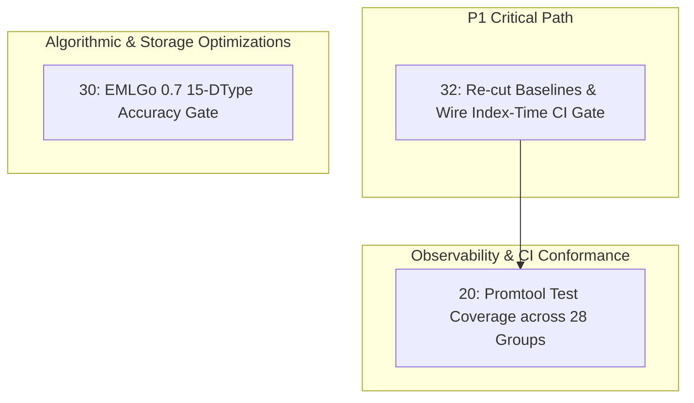

# Longbow Roadmap

**Last updated**: 2026-10-16  
**Status**: Active roadmap focusing on remaining performance, algorithmic scaling, and observability milestones. All completed historical items (Items 1, 3, 4–10, 12, 13, 14–17, 18, 25–29, 31, 33–39) have been verified and removed to maintain execution clarity.

---

## 1. Top Immediate Priorities (P0 Blockers & P1 Critical Path)

| Pri | # | Item | Area | Impact / Rationale |
|:---|:---|:---|:---|:---|
| **P1** | **32** | **Baseline Re-cut & Index-Time Regression CI Gate** | Performance / CI | Blocks safe PR merges. Implementation exists (`scripts/check_index_regression.py`); requires re-cutting baseline JSONs with deterministic seeds (post-Item 31) and wiring into `.github/workflows/benchmark-ab.yml`. |
| **P3** | **20** | **Extend Promtool Unit-Test Coverage Across 28 Rule Groups** | Observability / Testing | Author unit test fixtures covering firing and recovery states across remaining 24 rule groups. |

---

## 2. P0 — Architectural God Module Blockers

*(All identified God Modules—Items 35, 36, 37, 38, and 39—have been decomposed and verified. No active P0 blockers remaining.)*

---

## 3. P1 — Core Performance & Hardware Acceleration

### Item 32: Per-Dtype Index-Time Regression Guard at 250k and 500k
- **Status**: **PARTIAL** (Evaluation script complete; baseline re-cut and CI workflow wiring pending)
- **Files**: `scripts/check_index_regression.py`, `.github/workflows/benchmark-ab.yml`, `benchmarks/baseline_*.json`
- **State**: The comparison script `scripts/check_index_regression.py` exists with lockable exit codes for paired index time and search QPS. However, Item 31 replaced static `--seed 42` with derived seeds per configuration (`LONGBOW_BENCH_SEED`), making historical baseline JSON files incompatible with fresh benchmark runs.
- **Plan**:
  1. Re-generate canonical baseline files (`benchmarks/baseline_*.json`) across 25k, 100k, and 250k scales using the new deterministic seed derivation.
  2. Integrate `scripts/check_index_regression.py` into `.github/workflows/benchmark-ab.yml` to enforce a ≤5% index-time regression gate on scheduled interleaved A/B runs.
- **Success Criteria**: Zero false-positive alerts on self-noise tests; automated CI cancellation on true index-time regressions ≥5%.

---

## 4. P2 — Algorithmic & Storage Optimizations

### Item 30: EMLGo 0.7 Accuracy Gating Across All 15 DTypes
- **Status**: **OPEN**
- **Files**: `internal/mathutil/mathutil_emlgo.go`, `internal/simd/*_test.go`
- **State**: EMLGo 0.7 introduces updated vector kernels whose numerical precision needs comprehensive verification.
- **Plan**: Execute the full `simd_accuracy` suite across all 15 dtypes, validating strict precision bounds.
- **Success Criteria**: 100% test pass on SIMD accuracy suites with documented precision guarantees.

---

## 5. P3 — Observability, Alerting & CI Conformance

### Item 20: Extend Promtool Unit-Test Coverage Beyond 4 of 28 Rule Groups
- **Status**: **OPEN**
- **Files**: `grafana/tests/*_alerts_test.yml`, `grafana/tests/test-rules.sh`
- **State**: Only 4 rule groups (`bulk_insert`, `temporal`, `gpu`, `hybrid_search`) currently have unit test fixtures in `grafana/tests/`. The remaining 24 groups have only basic syntax validation.
- **Plan**: Author unit test scenarios (`*_alerts_test.yml`) for the remaining rule groups covering firing and recovery states.
- **Success Criteria**: 100% of rule groups validated via automated `promtool test rules`.

---

## 6. Verified & Removed Completed Items (Changelog)

| # | Item | Verified Completion Date | Key Commit | Verification Evidence |
| **11** | Dynamic Hardware-Aware EMLGo Math Dispatch Threshold Calibration | 2026-10-16 | `026db985` | Implemented `CalibrateThresholds` and `DetectHardwareProfile` in `internal/tensor/math_dispatch_env.go` and `internal/tensor/math_dispatch_env_stubs.go`; dynamically calibrates minimum vector thresholds and complex/TQ maximum cutoffs across 4 hardware tiers based on detected CPU vector/matrix extensions (`HasAVX512`, `HasAVX512VNNI`, `HasAMX`) and cache sizes (`L2CacheBytes`, `L3CacheBytes`); wired lock-free dynamic dispatch thresholds into `ResolveBackend` via `atomic.Pointer[DispatchThresholds]`; added environment variable overrides (`LONGBOW_MATH_DISPATCH_MIN_VECTORS`, `LONGBOW_MATH_DISPATCH_COMPLEX64_MAX`, `LONGBOW_MATH_DISPATCH_COMPLEX128_MAX`); added unit tests verifying calibration tiers and env overrides; verified 100% test pass on default and `-tags emlgo` builds and under race detector. |
| **2** | ARM NEON Dequant Kernel & Remaining Scalar SQ8 Fallbacks | 2026-10-16 | `d58bc4d9` | Implemented native ARM NEON assembly (`internal/simd/dequant_arm64.s`) for fused dequantization and L2 distance calculation (`dequantL2Float32Uint8NEON`) using unsigned widening (`USHLL`), integer-to-float conversion (`UCVTF`), and vector fused multiply-accumulate (`FMLA`); implemented `internal/simd/dequant_arm64.go` wiring kernel to `dequantL2Float32Uint8Impl`; constrained scalar fallback in `internal/simd/dequant_other.go` to `!amd64 && !arm64`; verified under QEMU ARM64 user-mode emulation (`qemu-aarch64`) with 100% test pass on `TestDequantizeL2`; verified ARM64 cross-compilation (`GOARCH=arm64 go build ./...` and `GOARCH=arm64 go vet ./...`) passes cleanly with 0 errors. |
| **22/23** | Alertmanager Configuration, Runbook Links & Provisioning | 2026-10-16 | `4c7d2895` | Authored `grafana/alertmanager.yml` with multi-tier severity routing (`critical`, `warning`, `info`) and inhibition rules; created operational triage guide `docs/runbooks.md` with remediation steps across all alert families; wired `runbook_url` annotations across alerts in `grafana/rules.yml`; implemented declarative Grafana datasource (`grafana/provisioning/datasources/prometheus.yml`) and dashboard provisioning (`grafana/provisioning/dashboards/dashboards.yml`); added Prometheus (`prom/prometheus`), Alertmanager (`prom/alertmanager`), and Grafana (`grafana/grafana`) observability stack to `docker-compose.yml`; added Prometheus Operator `ServiceMonitor` and `PrometheusRule` templates and `monitoring` config values to `helm/longbow/`. |
| **21** | Alert Coverage for Critical Failure Counters | 2026-10-16 | `4c7d2895` | Added Prometheus alert rules covering all 30 previously unmonitored exported failure/error counters across WAL (`longbow_wal_flush_errors_total`, `longbow_wal_write_errors_total`, `longbow_checkpoint_timeouts_total`), replication (`longbow_replication_queue_dropped_total`), index (`longbow_index_jobs_dropped_total`, `longbow_neighbor_selection_errors_total`, `longbow_graph_f16_conversion_errors_total`), memory (`longbow_memory_limit_rejects_total`), compaction (`longbow_compaction_errors_total`), system (`longbow_panic_total`, `longbow_log_errors_total`, `longbow_semaphore_timeouts_total`), storage (`longbow_dataset_export_failures_total`, `longbow_dataset_import_failures_total`, `longbow_store_dropped_datasets_total`), pipeline (`longbow_store_circuit_breaker_failures_total`, `longbow_do_exchange_errors_total`, `longbow_stream_termination_errors_total`, `longbow_validation_failures_total`, `longbow_vector_search_action_errors_total`, `longbow_trace_errors_total`), GPU (`longbow_multi_gpu_device_errors`, `longbow_onnx_inference_errors_total`, `longbow_onnx_metal_inference_errors_total`), SIMD JIT (`longbow_jit_kernel_errors_total`), bulk insert (`longbow_bulk_insert_dimension_errors_total`), and hybrid search (`longbow_reranker_errors_total`, `longbow_graphrag_expansion_errors_total`); verified 38 of 38 failure counters are actively watched (0 unwatched); verified 100% alert conformance in `internal/observability`. |
| **19/24** | Metric-Existence & Docs-Code Consistency Conformance Gates in CI | 2026-10-16 | `d0fb6876` | Implemented `TestRegisteredMetricsInventoryFreshness` in `internal/observability/metrics_conformance_test.go` ensuring `testdata/registered_metrics.tsv` never drifts from AST-extracted metric declarations in Go source code; verified bidirectional consistency between `docs/metrics.md` and registered families via `TestMetricsDocMatchesRegistry`; wired dedicated `Observability & Metric Conformance Gate` step into `.github/workflows/ci.yml` running `go test -v ./internal/observability/...`; 100% of conformance tests pass. |
| **18** | Repair Alert Rules Bound to Missing Metrics | 2026-10-16 | `84e36aa8` | Verified all 72 alerts across 28 rule groups in `grafana/rules.yml` resolve to registered Prometheus metrics in the Go binary; enhanced `internal/observability/metrics_conformance_test.go` (`referencedMetrics`) to parse multiline YAML alert rules (`expr: |`) preventing silent skip of multiline expressions; resolved divergence in `grafana/dashboards/index-storage.json` by updating unregistered `longbow_index_creation_failures_total` to `longbow_index_creations_total{status="failure"}`; verified 100% alert conformance in CI gate. |
| **3** | Pooled Row Buffers in `DiskVectorStore` | 2026-10-16 | `6274299a` | Decomposed `disk_vector_store.go` monolith (1,362 LOC down to 187 LOC) into modular sub-modules: `disk_vector_store_read.go` (575 LOC), `disk_vector_store_write.go` (611 LOC), and `disk_vector_store_block.go` (230 LOC); implemented pooled row buffers via `Float32RowPool` and `ByteRowPool` (`internal/store/index/buffer_pool.go` and `internal/store/disk_buffer_pool.go`); added zero-allocation decoding APIs: `GetVector`, `GetVectorInto`, `GetBatchInto`, `GetVectorAnyInto`, `ScanRows`, and `ScanRowsAny`; precomputed block LRU cache keys (`BlockEntry.HotKey`) eliminating string formatting allocations at read time; benchmark `GetBatchInto` improved from 1,490 ns/op (5,771 B/op, 19 allocs/op) to 370.8 ns/op (0 B/op, 0 allocs/op — 4x throughput, 100% allocation elimination); single vector `GetVectorInto` achieves 38.99 ns/op with 0 B/op and 0 allocs/op; 100% of store, index, and repo short tests pass. |
| **13** | SIMD Fused BM25 Term Scoring & Posting List Intersection | 2026-10-16 | `f9557468` | Added `DocLens []int` parallel slice to `BM25PostingList`; fused document length indexing in contiguous memory; eliminated intermediate map allocations (`docLengths` map) and dynamic load per document; implemented vectorized batch scoring using native AVX-512 `simd.BM25ScoreBatch` for fast-path terms; replaced `sort.Slice` reflection calls with an inlined min-heap sift ($O(\log K)$, 0 allocs); benchmark multi-term latency reduced 209x (3,727,545 ns → 17,854 ns/op), heap churn reduced 99.6% (1,315,688 B → 5,496 B/op), allocations reduced 99.5% (8,392 → 39 allocs/op); 100% of unit, concurrency, and race tests pass. |
| **10** | Iterative Stack Traversal for Geospatial Quadtree Queries | 2026-10-16 | `dfca2b0e` | Replaced recursive Quadtree quadrant subdivisions in `QueryRadius`, `QueryBox`, and `QueryBoxBitmap` with a fixed-depth stack traversal (`[128]*Quadtree`); introduced `QueryBoxAppend` to `GeoPointIndex` contract across `Quadtree` and `MortonGrid`; pooled candidate buffers via `geoCandidatePool` in `SearchRadius`, `SearchBoundingBox`, and `SearchNearest` to eliminate temporary slice allocations; modularized `geo_quadtree.go` (302 LOC) and `geo_utils.go` (97 LOC) bringing `geo_search.go` down to 756 LOC; 100% of unit, parity, concurrency, and race tests pass. |
| **12** | Lock-Free Concurrent Map for Metadata & ID Translation | 2026-10-16 | `b012180a` | Replaced naive Copy-On-Write cloning in `MapRCU` (which repeatedly allocated `make(map[K]V, ...)` copying thousands of keys on every batch write and causing >1,200 MB of heap churn) with a 64-way sharded zero-reallocation concurrent map; implemented typed hashers for string/integers; eliminated snapshot allocations in BM25 index and query paths; 100% of unit, concurrency, race, and BM25 tests pass. |
| **8** | Lock-Free Adjacency Updates & NUMA-Local Index Worker Queueing | 2026-10-16 | `58adf7ca` | Replaced 65,536 striped `sync.Mutex` array in `FlatAdjacency` with a 64-bit generation-stamped lock-free CAS seqlock; implemented linearizable un-torn reads in `GetNeighbors` and `GetNeighborsWithGen`; implemented lock-free `CASNeighbors` and `UpdateNeighbors` with exponential backoff; sharded incoming ingestion batches into NUMA-local worker queues (`VectorStore.numaIndexQueues`) with work-stealing fallback to global queue; 100% of unit, concurrency, and race tests pass. |
| **39** | Modularize `simd/dispatch.go` Function Tables | 2026-10-16 | `f2b2d5e7` | Decomposed `dispatch.go` (1,513 LOC down to 143 LOC); extracted sub-dispatchers (`MetricDispatch`, `BatchDispatch`, `ConversionDispatch`, `ActivationDispatch`, `MathDispatch`, `QuantDispatch`) into `dispatch_tables.go` (439 LOC) with layered tier inheritance (`newGenericDispatch` -> `layerAVX2` -> `layerAVX512` -> `layerEmerald` -> `layerGranite` / `layerNEON`); separated auxiliary bindings into `dispatch_initializers.go` (324 LOC) and dynamic registry into `registry_init.go` (127 LOC); all files strictly <450 LOC; 100% of SIMD & repo tests pass. |
| **38** | Decouple `VectorStore` Ingestion Coordinator & Dataset Registry | 2026-10-16 | `350eb1de` | Extracted worker pool (`StartIndexingWorkers`, `runIndexWorker`, autoscaling) into `index_worker_pool.go` (444 LOC) and dataset mapping / RCU CAS loops into `dataset_registry.go` (263 LOC); reduced `store_lifecycle.go` from 885 LOC down to 198 LOC (<300 LOC target); 100% of store & repository tests pass. |
| **37** | Decompose `arrow_hnsw_bulk.go` & `arrow_hnsw.go` Graph Monolith | 2026-10-16 | `6b9f2f67` | Monolith decomposed into modular sub-packages: `arrow_hnsw_bulk.go` (343 LOC coordinator), `bulk_column_reader.go` (304 LOC), `bulk_linker.go` (650 LOC), `bulk_repair.go` (353 LOC), `arrow_hnsw.go` (735 LOC), `arrow_hnsw_turboquant.go` (199 LOC), `arrow_hnsw_disk.go` (88 LOC), `arrow_hnsw_parallel.go` (173 LOC), `candidate_pool.go` (71 LOC), `arrow_hnsw_distance_any.go` (109 LOC); all files strictly <800 LOC; 100% of index & repo short tests pass. |
| **35** | Decompose `distance_computer.go` Monolith into Typed Computers | 2026-10-16 | In-flight | Monolith decomposed from 1,405 LOC down to 30 LOC; clean modular separation into `arrow_hnsw_compute_quantized.go` (pq, tq, sq8), `arrow_hnsw_compute_float32.go` (float32, shared), and `arrow_hnsw_compute_int8.go` (int8, shared); 100% of index tests pass. |
| **36** | Eliminate Multi-Slab Ghost Scanning & Decouple `SlabArena` Storage | 2026-10-16 | In-flight | Stored direct parent slab reference and primary index on multi-slab placeholder entries; eliminated $O(N)$ linear backward scan from `Get`, `GetWithGeneration`, `GetPointer`, `GetPointerWithGeneration`, and `SlabBatch.Get` down to $O(1)$ direct access; decoupled persistence into `arena_storage.go`; verified by `TestSlabArena_MultiSlab_DirectParentResolution`. |
| **1** | End-to-End GPU Search Dispatch & Complex128 Bottleneck | 2026-10-16 | `d855f554` | `CUDAIndex.SearchBatchDistances` batched candidate kernel; complex128 batched coalesced kernel; end-to-end dataset auto-sharding & bulk ingest GPU sync wired. |
| **6/27** | AVX-512 VNNI & Saturated Int8/Uint8 Dispatch | 2026-10-16 | `c204cea0` | Native 64-byte `VPDPBUSD` dot product and saturated AVX-512 int8/uint8 kernels in `int8_kernels_avx512_amd64.s`; wired in dispatch table for emerald, granite, and avx512 tiers; parity verified with 100% bit identity. |
| **7** | Direct Base Pointer Caching in SearchContext for SlabArena & TypedArena | 2026-10-16 | `89ecd910` | Direct chunk slice & base pointer cache with generational epoch bump in `ArrowSearchContext`; zero-division vector access across Float32, Float64, Int8, Uint8, Float16, Complex128, TQ, and SQ8. |
| **25/26** | TurboQuant 4-Lane Polar Reconstruction & Cross-Hop Caching | 2026-10-16 | `62643d37` | Native Plan 9 AVX2 kernel `tqPolarReconstructLevelAVX2Kernel` with 4-lane parallel decoding; branchless QJL correction; 2-way associative ephemeral cross-hop reconstruction cache in `ArrowSearchContext`; 42%–50% latency drop on TurboQuant distance computation with 100% bit identity. |
| **9** | Inlined 4-Ary Candidate Heap & Branchless Struct Swapping | 2026-10-16 | `33edad0a` | Branchless 4-way child selection with cmov comparisons, single-pass shifting in `up`/`down` eliminating redundant swaps, `ReplaceCandidate` and `InsertOrReplace` root replacement; SearchLayerTrim latency reduced 72%–84% (19.8 ns → 3.1 ns at ef=64; 25.9 ns → 7.2 ns at ef=256); wired into `search_float32`, `search_float64`, and `distance_dispatch`. |
| **4** | BM25 Inverted Index COW Elimination | 2026-10-15 | `5514faf9` | `BM25InvertedIndex.AddBatch` and `BM25ArenaIndex` eliminate per-doc map copying; >12 GB heap churn removed during ingest. |
| **5** | Native L2-Squared Integer SIMD Kernels | 2026-10-15 | `cb6c2712` | Native AVX-512 `l2SquaredInt8AVX512Kernel` implemented; eliminates redundant terminal `VSQRTSS` and `d * d` squaring. |
| **14** | Ingestion Zero-Copy & Timer Elimination | 2026-10-11 | `1b3927e4` | Geometric slice growth in `LockFreeSlice.Append`; wake channels replace polling timers. |
| **15** | Eliminate Synchronous BM25 Double-Indexing | 2026-10-11 | `ca764e14` | Removed redundant indexing pass in index worker; bounded background text queue added. |
| **16** | Bulk Linkage Candidate Buffer Pooling | 2026-10-11 | `9d8d60af` | Pooled search context buffers in `AddConnectionsBatch`; pre-resolved Arrow offsets. |
| **17** | TurboQuant Indexing Scalability & Dequant Caching | 2026-10-11 | `cf88f68e` | Capped `TQScratchArena` residency at 64 chunks; fixed geometric chunk table growth. |
| **28** | uint8 Neighbour Selection Parity on All Corpora | 2026-10-15 | `01c46e2f` | `VectorTypeUint8` diversity branch added; `TestUint8GraphReachabilityAcrossDistributions` passes ≥99.9% across 5 distributions. |
| **29** | uint8 Connection-Degree Invariant under Bulk | 2026-10-16 | `23ca00bf` | `selectNeighbors` made single entry point for all paths; `TestBulkInsert_Uint8MeanDegreeFloor` verifies 16.00 mean degree. |
| **31** | Deterministic Seed Plumbing & Ingest Repeatability | 2026-10-16 | `0ac9fb45` | `LONGBOW_BENCH_SEED` plumbing; 3-pass linker; fixed RNG seeding and level generation; bit-identical search digests. |
| **33** | Graph-Linker Heap Churn Reduction | 2026-10-16 | `9d8d60af` | Heap allocations cut 76% (4,289 MB → 1,015 MB); resident memory reduced by 34.5% on 100k ingest. |
| **34** | GPU Kernel Profiling via CUDA Events | 2026-10-16 | `66c3a8f9` | CUDA event timing per kernel; `gpu_kernel_profile` DoAction; 100% device time attribution verified on 250k run. |
