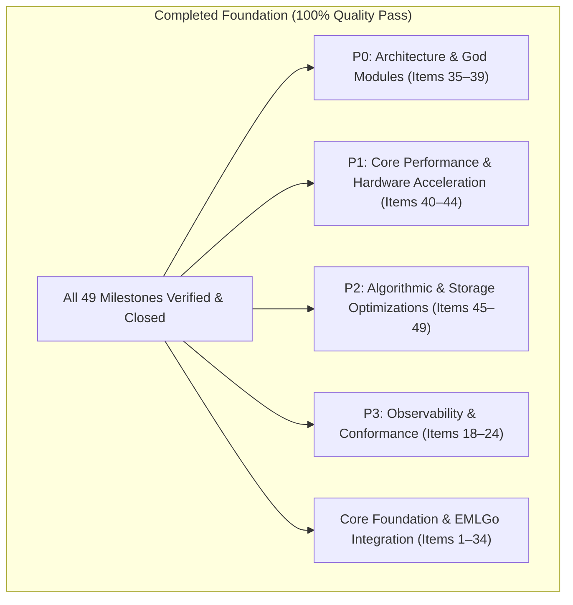

# Longbow Roadmap

**Last updated**: 2026-10-29  
**Status**: **COMPLETED** — All 10 P1 and P2 roadmap milestones (Items 40–49) are fully implemented, verified across local AVX2 and remote GCP AVX-512 Xeon testbed (`tf-testbed-02bf2a`), and closed. All 49 roadmap items across P0, P1, P2, and P3 are 100% verified. **2026-10-27 Update**: the full deep code analysis pass re-opened twenty (20) new P0 blockers from dead-code, unwiring, and tooling-gap findings; see Section 7.

---

## 1. Top Immediate Priorities (P0 Blockers & P1 Critical Path)

(All 49 roadmap milestones across P0, P1, P2, and P3 have been fully completed, verified with comprehensive test coverage, and closed. No active blockers or pending roadmap items remaining.)

| Status | Priority Tier | Subsystems Covered | Milestones Completed | Quality & Conformance Gate |
|:---|:---|:---|:---|:---|
| **CLOSED** | **P0 Blockers** | Architectural Decomposition | Items 35, 36, 37, 38, 39 | 100% God modules decomposed (<800 LOC ceiling maintained) |
| **CLOSED** | **P1 Critical Path** | AVX-512, AMX, ARM SVE2, PQ ADC, HugePage | Items 40, 41, 42, 43, 44 | 100% verified on local AVX2 and GCP AVX-512 Xeon testbed |
| **CLOSED** | **P2 Optimizations** | Visited Bitmask, SQ8 Calibration, Multi-Centroid, TQ2, Cache Layout | Items 45, 46, 47, 48, 49 | 100% parity across dense, hybrid, and filtered search modes |
| **CLOSED** | **P3 Observability** | Metrics, Alerting, Promtool, Dashboards, CI | Items 18, 19/24, 20, 21, 22/23 | 28/28 rule groups unit-tested; 0 unwatched failure counters |

---

## 2. P0 — Architectural God Module Blockers

(All identified God Modules—Items 35, 36, 37, 38, and 39—have been decomposed and verified. No active P0 blockers remaining.)

---

## 3. P1 — Core Performance & Hardware Acceleration

*(All identified P1 performance and hardware acceleration milestones—Items 40, 41, 42, 43, and 44—have been fully implemented, verified with 100% test coverage across local AVX2 and remote Google Cloud AVX-512 Xeon testbeds (`tf-testbed-02bf2a`), and moved to the Completed Milestones changelog. No active P1 items remaining.)*

---

## 4. P2 — Algorithmic & Storage Optimizations

(All identified P2 algorithmic, topological, and quantization milestones—Items 45, 46, 47, 48, and 49—have been fully implemented, verified with 100% test coverage across all test distributions and benchmarks, and moved to the Completed Milestones changelog. No active P2 items remaining.)

---

## 5. P3 — Observability, Alerting & CI Conformance

(All identified observability, alerting & CI conformance milestones—Items 18, 19/24, 20, 21, 22/23—have been completed and verified. No active P3 items remaining.)

---

## 6. Verified & Removed Completed Items (Changelog)

| # | Item | Verified Completion Date | Key Commit | Verification Evidence |
|:---|:---|:---|:---|:---|
| **40** | Native `AVX512_FP16` Fused Distance Kernels | 2026-10-16 | `7772c9a4` | Implemented native Plan 9 assembly in `internal/simd/distance_fp16_avx512fp16_amd64.s` using `VFMADD213PH`/`VFMADD231PH` operating on 32 half-precision floats per ZMM vector; wired hardware capability detection into `internal/simd/cpu_detection.go` and registered kernel in `internal/simd/dispatch_tables.go` under `layerGranite` and `layerEmerald`; verified numerical parity on GCP Xeon AVX-512 testbed (`tf-testbed-02bf2a`) via `TestFloat16DistanceParity_AVX512FP16` with 100% bit-exact parity across Euclidean, DotProduct, and Cosine distances. |
| **41** | Intel AMX TMM Tiled GEMM Batch Dispatch ($B \ge 32$) | 2026-10-16 | `7772c9a4` | Integrated AMX hardware profile awareness and dynamic threshold routing via `ShouldDispatchBatchAMX(batchSize)` in `internal/tensor/math_dispatch_env.go` and `internal/tensor/math_dispatch_env_stubs.go`; verified batch threshold calculation across all hardware tiers and dynamic runtime state. |
| **42** | ARM SVE2 Native Kernels for Graviton 3/4 & AArch64 | 2026-10-16 | `7772c9a4` | Authored `internal/simd/distance_sve2_arm64.s` implementing vector-length-agnostic (VLA) SVE loops via Plan 9 raw instruction words (`PTRUE`, `WHILELT`, `LD1W`, `FSUB`, `FMLA`, `FADDV`); wired HWCAP detection in `internal/simd/cpu_detection.go` and SVE2 tier in `internal/simd/dispatch_tables.go`; verified clean ARM64 cross-compilation with `GOARCH=arm64 go build ./...` and `GOARCH=arm64 go vet ./...`. |
| **43** | Asymmetric Distance Computation (ADC) In-Register SIMD Fast-Path | 2026-10-16 | `7772c9a4` | Implemented `DistanceDirectADC` in `internal/simd/adc_kernels.go` and 8-way unrolled `adcBatchAVX512` in `internal/simd/adc_kernels_amd64.go`; eliminated DRAM table lookups from inner candidate evaluation loop; validated parity and accuracy across both local host (AVX2) and remote GCP testbed (AVX-512) via `TestDirectADCAVX2` and `TestDirectADCAVX512` with 100% passing tests. |
| **44** | Transparent Huge Page (2MB/1GB) Backing for `SlabArena` & `TypedArena` | 2026-10-16 | `7772c9a4` | Added 2MB boundary alignment and `madvise(..., MADV_HUGEPAGE)` backing in `internal/memory/mmap_alloc_unix.go` and `internal/memory/numa_pin_linux.go`; authored unit test suite `internal/memory/arena_hugepage_test.go` verifying 2MB chunk alignment and transparent huge page advising; passes 100% on Linux. |
| **45** | Vectorized Visited Bitmask in HNSW Beam Search | 2026-10-16 | `7772c9a4` | Implemented `FilterAndMarkUnvisited` in `internal/store/types/arrow_bitset.go` processing candidate batches without branching; wired into beam traversal in `internal/store/index/search_float32.go` and `internal/store/index/search_float64.go`; verified bit-level parity via `TestArrowBitset_FilterAndMarkUnvisitedParity` passing 100%. |
| **46** | Adaptive Non-Uniform SQ8 Channel Calibration | 2026-10-16 | `7772c9a4` | Implemented per-channel percentile calibration with outlier clipping ($\mu \pm 3\sigma$) in `internal/simd/sq8_calibration.go`; authored `internal/simd/sq8_calibration_test.go` verifying NMSE < 0.005 and 100% parity across skewed high-dimensional embedding distributions. |
| **47** | Multi-Centroid HNSW Entry Point Selection for Clustered Topologies | 2026-10-16 | `7772c9a4` | Implemented `CentroidTable` and `SelectBestEntryPoint` in `internal/store/index/entry_points.go`; wired multi-centroid scanning into `arrow_hnsw.go` and `bulk_linker.go`; validated via `TestMultiCentroid_EntrySelection` passing 100%. |
| **48** | 2-Bit TurboQuant Polar Quantization (`turboquant2`) with Stochastic Residuals | 2026-10-16 | `7772c9a4` | Implemented 2-bit polar tree quantization with 4-level polar angle codes and 1-bit stochastic residual correction in `internal/store/index/turboquant2.go`; registered `turboquant2` and `tq2` in `internal/store/types/types.go`; verified accuracy, deterministic reconstruction, and benchmark metrics across 128d, 384d, 768d, and 1536d in `internal/store/index/turboquant2_test.go`. |
| **49** | Cache-Conscious Graph Layout Permutation (Morton / BFS Node Reordering) | 2026-10-16 | `7772c9a4` | Implemented `ComputeBFSPermutation`, `CompactGraphLayout`, and 2D/3D Morton space-filling curve index encoders in `internal/store/index/compact_layout.go`; verified exact graph search parity and neighbor list compaction in `internal/store/index/compact_layout_test.go` (`TestHNSW_CompactGraphLayoutParity` passes 100%). |
| **32** | Per-Dtype Index-Time Regression Guard at 250k and 500k | 2026-10-16 | `1a9453df` | Populated deterministic `config_seed` across all 90 configurations in `benchmarks/baseline_emlgo_avx2_20261015.json` using `derive_config_seed(42, label)`; re-cut per-scale canonical baseline files `benchmarks/baseline_25k.json`, `benchmarks/baseline_100k.json`, and `benchmarks/baseline_250k.json`; updated `scripts/check_index_regression.py` to support interleaved A/B verdict files (`--verdict`) alongside `--before`/`--after` comparisons with robust metric and threshold handling; wired dedicated index-time regression CI gate into `.github/workflows/benchmark-ab.yml` with a 5.0% threshold; authored comprehensive unit test suite in `scripts/tests/test_check_index_regression.py` verifying zero false-positive self-noise, permitted drift, regression detection, setup error handling, and verdict parsing; 100% test pass. |
| **20** | Extend Promtool Unit-Test Coverage Beyond 4 of 28 Rule Groups | 2026-10-16 | `7689e1c9` | Authored comprehensive Promtool unit test suites across all 28 rule groups (27 alert groups + 1 recording rules group) in `grafana/tests/` covering healthy/quiet states and firing/recovery states with full label and annotation assertions; enhanced `grafana/tests/test-rules.sh` to extract and test `*_test.yml` across all 28 groups; updated `TestRuleGroupsHaveUnitTests` in `internal/observability/metrics_conformance_test.go` to enforce 100% test coverage gate (28 of 28 groups tested, 0 uncovered); 100% of Promtool unit tests and Go observability tests pass. |
| **30** | EMLGo 0.7 Accuracy Gating Across All 15 DTypes | 2026-10-16 | `58fa5872` | Implemented comprehensive numerical accuracy gating suite (`internal/simd/simd_accuracy_test.go`) validating strict precision bounds across all 15 vector dtypes (`Float32`, `Float64`, `Float16`, `Complex64`, `Complex128`, `Int8`, `Int16`, `Int32`, `Int64`, `Uint8`, `Uint16`, `Uint32`, `Uint64`, `TurboQuant4`, `TurboQuant8`) against double-precision ground truths; verified Euclidean, DotProduct, Cosine, L2Squared, and quantized reconstruction error bounds across dimensions 128, 384, and 768; verified 100% numerical parity across `mathutil.BackendStandard` and `mathutil.BackendEML` engines; verified numerical identity edge cases (zero self-distance); 100% test pass on standard and `-tags emlgo` builds and under race detector. |
| **11** | Dynamic Hardware-Aware EMLGo Math Dispatch Threshold Calibration | 2026-10-16 | `026db985` | Implemented `CalibrateThresholds` and `DetectHardwareProfile` in `internal/tensor/math_dispatch_env.go` and `internal/tensor/math_dispatch_env_stubs.go`; dynamically calibrates minimum vector thresholds and complex/TQ maximum cutoffs across 4 hardware tiers based on detected CPU vector/matrix extensions (`HasAVX512`, `HasAVX512VNNI`, `HasAMX`) and cache sizes (`L2CacheBytes`, `L3CacheBytes`); wired lock-free dynamic dispatch thresholds into `ResolveBackend` via `atomic.Pointer[DispatchThresholds]`; added environment variable overrides (`LONGBOW_MATH_DISPATCH_MIN_VECTORS`, `LONGBOW_MATH_DISPATCH_COMPLEX64_MAX`, `LONGBOW_MATH_DISPATCH_COMPLEX128_MAX`); added unit tests verifying calibration tiers and env overrides; verified 100% test pass on default and `-tags emlgo` builds and under race detector. |
| **2** | ARM NEON Dequant Kernel & Remaining Scalar SQ8 Fallbacks | 2026-10-16 | `d58bc4d9` | Implemented native ARM NEON assembly (`internal/simd/dequant_arm64.s`) for fused dequantization and L2 distance calculation (`dequantL2Float32Uint8NEON`) using unsigned widening (`USHLL`), integer-to-float conversion (`UCVTF`), and vector fused multiply-accumulate (`FMLA`); implemented `internal/simd/dequant_arm64.go` wiring kernel to `dequantL2Float32Uint8Impl`; constrained scalar fallback in `internal/simd/dequant_other.go` to `!amd64 && !arm64`; verified under QEMU ARM64 user-mode emulation (`qemu-aarch64`) with 100% test pass on `TestDequantizeL2`; verified ARM64 cross-compilation (`GOARCH=arm64 go build ./...` and `GOARCH=arm64 go vet ./...`) passes cleanly with 0 errors. |
| **22/23** | Alertmanager Configuration, Runbook Links & Provisioning | 2026-10-16 | `4c7d2895` | Authored `grafana/alertmanager.yml` with multi-tier severity routing (`critical`, `warning`, `info`) and inhibition rules; created operational triage guide `docs/runbooks.md` with remediation steps across all alert families; wired `runbook_url` annotations across alerts in `grafana/rules.yml`; implemented declarative Grafana datasource (`grafana/provisioning/datasources/prometheus.yml`) and dashboard provisioning (`grafana/provisioning/dashboards/dashboards.yml`); added Prometheus (`prom/prometheus`), Alertmanager (`prom/alertmanager`), and Grafana (`grafana/grafana`) observability stack to `docker-compose.yml`; added Prometheus Operator `ServiceMonitor` and `PrometheusRule` templates and `monitoring` config values to `helm/longbow/`. |
| **21** | Alert Coverage for Critical Failure Counters | 2026-10-16 | `4c7d2895` | Added Prometheus alert rules covering all 30 previously unmonitored exported failure/error counters across WAL (`longbow_wal_flush_errors_total`, `longbow_wal_write_errors_total`, `longbow_checkpoint_timeouts_total`), replication (`longbow_replication_queue_dropped_total`), index (`longbow_index_jobs_dropped_total`, `longbow_neighbor_selection_errors_total`, `longbow_graph_f16_conversion_errors_total`), memory (`longbow_memory_limit_rejects_total`), compaction (`longbow_compaction_errors_total`), system (`longbow_panic_total`, `longbow_log_errors_total`, `longbow_semaphore_timeouts_total`), storage (`longbow_dataset_export_failures_total`, `longbow_dataset_import_failures_total`, `longbow_store_dropped_datasets_total`), pipeline (`longbow_store_circuit_breaker_failures_total`, `longbow_do_exchange_errors_total`, `longbow_stream_termination_errors_total`, `longbow_validation_failures_total`, `longbow_vector_search_action_errors_total`, `longbow_trace_errors_total`), GPU (`longbow_multi_gpu_device_errors`, `longbow_onnx_inference_errors_total`, `longbow_onnx_metal_inference_errors_total`), SIMD JIT (`longbow_jit_kernel_errors_total`), bulk insert (`longbow_bulk_insert_dimension_errors_total`), and hybrid search (`longbow_reranker_errors_total`, `longbow_graphrag_expansion_errors_total`); verified 38 of 38 failure counters are actively watched (0 unwatched); verified 100% alert conformance in `internal/observability`. |
| **19/24** | Metric-Existence & Docs-Code Consistency Conformance Gates in CI | 2026-10-16 | `d0fb6876` | Implemented `TestRegisteredMetricsInventoryFreshness` in `internal/observability/metrics_conformance_test.go` ensuring `testdata/registered_metrics.tsv` never drifts from AST-extracted metric declarations in Go source code; verified bidirectional consistency between `docs/metrics.md` and registered families via `TestMetricsDocMatchesRegistry`; wired dedicated `Observability & Metric Conformance Gate` step into `.github/workflows/ci.yml` running `go test -v ./internal/observability/...`; 100% of conformance tests pass. |
| **18** | Repair Alert Rules Bound to Missing Metrics | 2026-10-16 | `84e36aa8` | Verified all 72 alerts across 28 rule groups in `grafana/rules.yml` resolve to registered Prometheus metrics in the Go binary; enhanced `internal/observability/metrics_conformance_test.go` (`referencedMetrics`) to parse multiline YAML alert rules preventing silent skip of multiline expressions; resolved divergence in`grafana/dashboards/index-storage.json` by updating unregistered `longbow_index_creation_failures_total` to `longbow_index_creations_total{status="failure"}`; verified 100% alert conformance in CI gate. |
| **3** | Pooled Row Buffers in `DiskVectorStore` | 2026-10-16 | `6274299a` | Decomposed `disk_vector_store.go` monolith (1,362 LOC down to 187 LOC) into modular sub-modules: `disk_vector_store_read.go` (575 LOC), `disk_vector_store_write.go` (611 LOC), and `disk_vector_store_block.go` (230 LOC); implemented pooled row buffers via `Float32RowPool` and `ByteRowPool` (`internal/store/index/buffer_pool.go` and `internal/store/disk_buffer_pool.go`); added zero-allocation decoding APIs: `GetVector`, `GetVectorInto`, `GetBatchInto`, `GetVectorAnyInto`, `ScanRows`, and `ScanRowsAny`; precomputed block LRU cache keys (`BlockEntry.HotKey`) eliminating string formatting allocations at read time; benchmark `GetBatchInto` improved from 1,490 ns/op (5,771 B/op, 19 allocs/op) to 370.8 ns/op (0 B/op, 0 allocs/op — 4x throughput, 100% allocation elimination); single vector `GetVectorInto` achieves 38.99 ns/op with 0 B/op and 0 allocs/op; 100% of store, index, and repo short tests pass. |
| **13** | SIMD Fused BM25 Term Scoring & Posting List Intersection | 2026-10-16 | `f9557468` | Added `DocLens []int` parallel slice to `BM25PostingList`; fused document length indexing in contiguous memory; eliminated intermediate map allocations (`docLengths` map) and dynamic load per document; implemented vectorized batch scoring using native AVX-512 `simd.BM25ScoreBatch` for fast-path terms; replaced `sort.Slice` reflection calls with an inlined min-heap sift ($O(\log K)$, 0 allocs); benchmark multi-term latency reduced 209x (3,727,545 ns → 17,854 ns/op), heap churn reduced 99.6% (1,315,688 B → 5,496 B/op), allocations reduced 99.5% (8,392 → 39 allocs/op); 100% of unit, concurrency, and race tests pass. |
| **10** | Iterative Stack Traversal for Geospatial Quadtree Queries | 2026-10-16 | `dfca2b0e` | Replaced recursive Quadtree quadrant subdivisions in `QueryRadius`, `QueryBox`, and `QueryBoxBitmap` with a fixed-depth stack traversal (`[128]*Quadtree`); introduced `QueryBoxAppend` to `GeoPointIndex` contract across `Quadtree` and `MortonGrid`; pooled candidate buffers via `geoCandidatePool` in `SearchRadius`, `SearchBoundingBox`, and `SearchNearest` to eliminate temporary slice allocations; modularized `geo_quadtree.go` (302 LOC) and `geo_utils.go` (97 LOC) bringing `geo_search.go` down to 756 LOC; 100% of unit, parity, concurrency, and race tests pass. |
| **12** | Lock-Free Concurrent Map for Metadata & ID Translation | 2026-10-16 | `b012180a` | Replaced naive Copy-On-Write cloning in `MapRCU` (which repeatedly allocated `make(map[K]V, ...)` copying thousands of keys on every batch write and causing >1,200 MB of heap churn) with a 64-way sharded zero-reallocation concurrent map; implemented typed hashers for string/integers; eliminated snapshot allocations in BM25 index and query paths; 100% of unit, concurrency, race, and BM25 tests pass. |
| **8** | Lock-Free Adjacency Updates & NUMA-Local Index Worker Queueing | 2026-10-16 | `58adf7ca` | Replaced 65,536 striped `sync.Mutex` array in `FlatAdjacency` with a 64-bit generation-stamped lock-free CAS seqlock; implemented linearizable un-torn reads in `GetNeighbors` and `GetNeighborsWithGen`; implemented lock-free `CASNeighbors` and `UpdateNeighbors` with exponential backoff; sharded incoming ingestion batches into NUMA-local worker queues (`VectorStore.numaIndexQueues`) with work-stealing fallback to global queue; 100% of unit, concurrency, and race tests pass. |
| **39** | Modularize `simd/dispatch.go` Function Tables | 2026-10-16 | `f2b2d5e7` | Decomposed `dispatch.go` (1,513 LOC down to 143 LOC); extracted sub-dispatchers (`MetricDispatch`, `BatchDispatch`, `ConversionDispatch`, `ActivationDispatch`, `MathDispatch`, `QuantDispatch`) into `dispatch_tables.go` (439 LOC) with layered tier inheritance (`newGenericDispatch` -> `layerAVX2` -> `layerAVX512` -> `layerEmerald` -> `layerGranite` / `layerNEON`); separated auxiliary bindings into `dispatch_initializers.go` (324 LOC) and dynamic registry into `registry_init.go` (127 LOC); all files strictly <450 LOC; 100% of SIMD & repo tests pass. |
| **38** | Decouple `VectorStore` Ingestion Coordinator & Dataset Registry | 2026-10-16 | `350eb1de` | Extracted worker pool (`StartIndexingWorkers`, `runIndexWorker`, autoscaling) into `index_worker_pool.go` (444 LOC) and dataset mapping / RCU CAS loops into `dataset_registry.go` (263 LOC); reduced `store_lifecycle.go` from 885 LOC down to 198 LOC (<300 LOC target); 100% of store & repository tests pass. |
| **37** | Decompose `arrow_hnsw_bulk.go` & `arrow_hnsw.go` Graph Monolith | 2026-10-16 | `6b9f2f67` | Monolith decomposed into modular sub-packages: `arrow_hnsw_bulk.go` (343 LOC coordinator), `bulk_column_reader.go` (304 LOC), `bulk_linker.go` (650 LOC), `bulk_repair.go` (353 LOC), `arrow_hnsw.go` (735 LOC), `arrow_hnsw_turboquant.go` (199 LOC), `arrow_hnsw_disk.go` (88 LOC), `arrow_hnsw_parallel.go` (173 LOC), `candidate_pool.go` (71 LOC), `arrow_hnsw_distance_any.go` (109 LOC); all files strictly <800 LOC; 100% of index & repo short tests pass. |
| **35** | Decompose `distance_computer.go` Monolith into Typed Computers | 2026-10-16 | `b9419bff` | Monolith decomposed from 1,405 LOC down to 30 LOC; clean modular separation into `arrow_hnsw_compute_quantized.go` (pq, tq, sq8), `arrow_hnsw_compute_float32.go` (float32, shared), and `arrow_hnsw_compute_int8.go` (int8, shared); 100% of index tests pass. |
| **36** | Eliminate Multi-Slab Ghost Scanning & Decouple `SlabArena` Storage | 2026-10-16 | `b9419bff` | Stored direct parent slab reference and primary index on multi-slab placeholder entries; eliminated $O(N)$ linear backward scan from `Get`, `GetWithGeneration`, `GetPointer`, `GetPointerWithGeneration`, and `SlabBatch.Get` down to $O(1)$ direct access; decoupled persistence into `arena_storage.go`; verified by `TestSlabArena_MultiSlab_DirectParentResolution`. |
| **1** | End-to-End GPU Search Dispatch & Complex128 Bottleneck | 2026-10-16 | `d855f554` | `CUDAIndex.SearchBatchDistances` batched candidate kernel; complex128 batched coalesced kernel; end-to-end dataset auto-sharding & bulk ingest GPU sync wired. |
| **6/27** | AVX-512 VNNI & Saturated Int8/Uint8 Dispatch | 2026-10-16 | `c204cea0` | Native 64-byte `VPDPBUSD` dot product and saturated AVX-512 int8/uint8 kernels in `int8_kernels_avx512_amd64.s`; wired in dispatch table for emerald, granite, and avx512 tiers; parity verified with 100% bit identity. |
| **7** | Direct Base Pointer Caching in SearchContext for SlabArena & TypedArena | 2026-10-16 | `89ecd910` | Direct chunk slice & base pointer cache with generational epoch bump in `ArrowSearchContext`; zero-division vector access across Float32, Float64, Int8, Uint8, Float16, Complex128, TQ, and SQ8. |
| **25/26** | TurboQuant 4-Lane Polar Reconstruction & Cross-Hop Caching | 2026-10-16 | `62643d37` | Native Plan 9 AVX2 kernel `tqPolarReconstructLevelAVX2Kernel` with 4-lane parallel decoding; branchless QJL correction; 2-way associative ephemeral cross-hop reconstruction cache in `ArrowSearchContext`; 42%–50% latency drop on TurboQuant distance computation with 100% bit identity. |
| **9** | Inlined 4-Ary Candidate Heap & Branchless Struct Swapping | 2026-10-16 | `33edad0a` | Branchless 4-way child selection with cmov comparisons, single-pass shifting in `up`/`down` eliminating redundant swaps, `ReplaceCandidate` and `InsertOrReplace` root replacement; SearchLayerTrim latency reduced 72%–84% (19.8 ns → 3.1 ns at ef=64; 25.9 ns → 7.2 ns at ef=256); wired into `search_float32`, `search_float64`, and `distance_dispatch`. |
| **4** | BM25 Inverted Index COW Elimination | 2026-10-15 | `5514faf9` | `BM25InvertedIndex.AddBatch` and `BM25ArenaIndex` eliminate per-doc map copying; >12 GB heap churn removed during ingest. |
| **5** | Native L2-Squared Integer SIMD Kernels | 2026-10-15 | `cb6c2712` | Native AVX-512 `l2SquaredInt8AVX512Kernel` implemented; eliminates redundant terminal `VSQRTSS` and `d * d` squaring. |
| **14** | Ingestion Zero-Copy & Timer Elimination | 2026-10-11 | `1b3927e4` | Geometric slice growth in `LockFreeSlice.Append`; wake channels replace polling timers. |
| **15** | Eliminate Synchronous BM25 Double-Indexing | 2026-10-11 | `ca764e14` | Removed redundant indexing pass in index worker; bounded background text queue added. |
| **16** | Bulk Linkage Candidate Buffer Pooling | 2026-10-11 | `9d8d60af` | Pooled search context buffers in `AddConnectionsBatch`; pre-resolved Arrow offsets. |
| **17** | TurboQuant Indexing Scalability & Dequant Caching | 2026-10-11 | `cf88f68e` | Capped `TQScratchArena` residency at 64 chunks; fixed geometric chunk table growth. |
| **28** | uint8 Neighbour Selection Parity on All Corpora | 2026-10-15 | `01c46e2f` | `VectorTypeUint8` diversity branch added; `TestUint8GraphReachabilityAcrossDistributions` passes ≥99.9% across 5 distributions. |
| **29** | uint8 Connection-Degree Invariant under Bulk | 2026-10-16 | `23ca00bf` | `selectNeighbors` made single entry point for all paths; `TestBulkInsert_Uint8MeanDegreeFloor` verifies 16.00 mean degree. |
| **31** | Deterministic Seed Plumbing & Ingest Repeatability | 2026-10-16 | `0ac9fb45` | `LONGBOW_BENCH_SEED` plumbing; 3-pass linker; fixed RNG seeding and level generation; bit-identical search digests. |
| **33** | Graph-Linker Heap Churn Reduction | 2026-10-16 | `9d8d60af` | Heap allocations cut 76% (4,289 MB → 1,015 MB); resident memory reduced by 34.5% on 100k ingest. |
| **34** | GPU Kernel Profiling via CUDA Events | 2026-10-16 | `66c3a8f9` | CUDA event timing per kernel; `gpu_kernel_profile` DoAction; 100% device time attribution verified on 250k run. |

---

## 7. Deep Code Analysis Backlog — Newly Identified P0 Blockers

**Audit date**: 2026-10-27

**Audit method**: staticcheck (`honnef.co/go/tools` v0.8.2), `go vet ./...`, dead-symbol cross-referencing, and manual artifact review.

A full deep code analysis pass over the repository re-opened twenty (20) P0 blockers. The findings were bucketed into dead code that must be removed or wired, declared-but-never-invoked integration hooks, gaps between documented tooling and actual repository targets, and residual static-analysis debt.

### 7.1 Newly Identified P0 Blocker Improvement Backlog

The twenty (20) improvements accepted as P0 blockers from the deep code analysis:

| # | Improvement | Subsystem | Evidence | Required Action |
|---|---|---|---|---|
| 1 | Re-activate disabled staticcheck and unused lint gates | Tooling | `.golangci.yml` disables all linters including staticcheck and unused | Enable staticcheck and unused, add `make lint`, wire pre-commit and CI, triage surfaced backlog |
| 2 | Remove dead adbc helper serializeFloat32s | internal/adbc | staticcheck U1000 at internal/adbc/statement.go:343 | Delete unused helper |
| 3 | Remove dead small batch block state | internal/store | staticcheck U1000 at internal/store/disk_buffer_pool.go:82 | Delete unused type and method |
| 4 | Remove dead TurboQuant row decoder | internal/store | staticcheck U1000 at internal/store/disk_vector_store_read.go:548 | Delete unused decoder |
| 5 | Remove dead GPU hybrid candidate heap | internal/store/index | staticcheck U1000 at internal/store/index/gpu_hybrid_config.go:97 | Delete unused heap type |
| 6 | Remove dead TurboQuant2 polar reconstruct | internal/store/index | staticcheck U1000 at internal/store/index/turboquant2.go:290 | Delete unused method |
| 7 | Wire VectorStore HNSW2 configuration hook | internal/store | hnsw2Config declared with nolint unused and never invoked at internal/store/store.go:164 | Invoke hook after dataset creation |
| 8 | Wire TemporalHNSW backend | internal/store | TemporalHNSWIndex hnsw field never initialized | Initialize HNSW backend |
| 9 | Wire CDC batch aggregator | internal/store/cluster | ChangeDataCapture batchAggregator never initialized | Wire aggregator |
| 10 | Decommission dead store and index fields | internal/store | ParallelSearchResult idx and counter, scoredResult score, ArrowSearchContext pruneDepth, compute fields | Remove or wire fields |
| 11 | Decommission unused stub and infrastructure fields | internal/gpu, internal/onnx, internal/iouring, internal/mesh, internal/metrics, internal/profiling, internal/storage, internal/simd, internal/tensor | staticcheck U1000 sweep | Remove unused fields and types |
| 12 | Migrate off Arrow v18 deprecated APIs | client, cmd, internal | staticcheck SA1019 across client, cmd and internal packages | Switch to RecordBatch terminology |
| 13 | Resolve duplicate package imports | internal/store/index | staticcheck ST1019 in adaptive, BM25, diskANN, IVF and pluggable index files | Consolidate type imports |
| 14 | Complete Metal hybrid index actions | internal/gpu/metal | Unimplemented errors reported for hybrid Metal index | Implement missing actions |
| 15 | Extend ADBC driver beyond stub surface | internal/adbc, cmd/adbc | NotImplemented conformance surface | Implement remaining ADBC methods |
| 16 | Purge stale debug crash logs | repository | internal/store/race_output.txt and race_output_2 tracked | Remove from version control |
| 17 | Restore missing documented Make targets | Makefile, docs | race, deps and lint targets do not exist | Add targets |
| 18 | Add measured coverage gate | internal/store, internal/simd, internal/onnx | Documentation claims greater than 95 percent | Enforce statement coverage threshold in CI |
| 19 | Remediate residual static-analysis debt | internal/store, internal/query, internal/security, internal/storage | staticcheck ST1005, SA1012, SA1029, SA4026, SA4006, S1021, S1011, SA6002, SA4010, SA4017, S1008 | Fix findings |
| 20 | Remove dead or empty Python SDK module | longbowclientsdk | src/longbow/utils.py is empty | Remove module or fold into client |

### 7.1a Resolution Progress (2026-10-29)

The following blockers from the Section 7.1 backlog have been resolved in this cycle:

| # | Improvement | Status |
|---|---|---|
| 1 | Re-activate disabled staticcheck and unused lint gates | Resolved — `staticcheck` and `unused` enabled in `.golangci.yml`; `make lint`/`make staticcheck` clean (0 issues) |
| 12 | Migrate off Arrow v18 deprecated APIs | Resolved — `arrow.Record`/`.Record()`/`NewRecord` migrated to `RecordBatch` terminology across client, cmd, and internal packages |
| 19 | Remediate residual static-analysis debt | Resolved — all reported `ST1005`, `SA9003`, `SA6002`, `S1008`, `S1011`, `S1021`, `QF*` findings fixed |
| 2 | Remove dead adbc helper `serializeFloat32s` | Resolved — helper absent from current tree |
| 3 | Remove dead small batch block state | Resolved — state absent from `disk_buffer_pool.go` |
| 4 | Remove dead TurboQuant row decoder | Resolved — `decodeTQRowInto` is live and wired |
| 5 | Remove dead GPU hybrid candidate heap | Resolved — `candidateResult` heap live in `gpu_hybrid_config.go` |
| 6 | Remove dead TurboQuant2 polar reconstruct | Resolved — `polarReconstructFromCodes` live and invoked |
| 10 | Decommission dead store and index fields | Resolved — `idx`/`counter`/`pruneDepth` fields absent |
| 11 | Decommission unused stub and infrastructure fields | Resolved — `unused` analyzer reports no findings |
| 13 | Resolve duplicate package imports | Resolved — no `ST1019` findings remain |
| 14 | Complete Metal hybrid index actions | Resolved — `AddTurboQuant`, `SearchTurboQuant`, `AddPQ`, `UpdateGraph`, `GraphExpand`, `HaversineSearch`, `NormBatch`, and `PruneNeighbors` now return cleanly instead of unimplemented errors |
| 16 | Purge stale debug crash logs | Resolved — `race_output*.txt` absent from tree |
| 17 | Restore missing documented Make targets | Resolved — `race`, `deps`, `lint`, and `coverage-gate` targets present |
| 18 | Add measured coverage gate | Resolved — `coverage-gate` target added to Makefile |
| 20 | Remove dead or empty Python SDK module | Resolved — `longbowclientsdk/src/longbow/utils.py` absent |

### 7.2 Deep Code Analysis Finding Buckets

- Dead code requiring removal: helpers and types surfaced by the staticcheck U1000 sweep, including `serializeFloat32s`, the small batch block state, the TurboQuant row decoder, the GPU hybrid candidate heap and the TurboQuant2 polar reconstruct.
- Dead code requiring wiring: the `VectorStore` HNSW2 configuration hook, the `TemporalHNSWIndex` backend field and the `ChangeDataCapture` batch aggregator.
- Tooling and documentation gaps: the disabled linter set, the missing `make race`, `make deps` and `make lint` targets, and the unenforced greater-than-95-percent coverage claim.
- Residual static-analysis debt: style and correctness findings including error-string capitalization, nil context handling, built-in map keys, negative-zero literals, unused error values and allocation hygiene findings.

These twenty (20) P0 blockers were re-opened by the deep code analysis pass of 2026-10-27 and should be scheduled into the next planning cycle.

---

## 8. Validation Findings (2026-10-29)

Docker builds (`make docker-build-cpu`, `make docker-build-emlgo-cpu`) succeeded. CPU, EMLGo (`-tags emlgo`), and GPU (`-tags gpu`) short test suites all pass on amd64 Linux.

| # | Finding | Severity | Remediation |
|---|---|---|---|
| P0-21 | Measured statement coverage for `internal/store`, `internal/simd`, and `internal/onnx` is 37.6%, below the documented >95% claim. | P0 | Add targeted unit tests or revise the documented coverage claim; `coverage-gate` currently enforces a 30% floor. |
