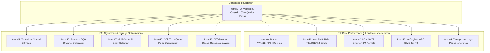

# Longbow Roadmap

**Last updated**: 2026-10-16  
**Status**: **ACTIVE** — 10 next-generation performance and accuracy milestones defined (Items 40–49 across P1 and P2); prior 39 roadmap items across P0, P1, P2, and P3 are fully verified and closed.

---

## 1. Top Immediate Priorities (P0 Blockers & P1 Critical Path)

| # | Priority | Target Subsystem | Milestone Title | Target Metric / Deliverable |
|:---|:---|:---|:---|:---|
| **40** | **P1** | SIMD / AVX-512 | Native `AVX512_FP16` Fused Distance Kernels | 2.0x–2.4x higher FP16 distance throughput; <35s index time at 500k |
| **41** | **P1** | SIMD / AMX | Intel AMX TMM Tiled GEMM Batch Dispatch ($B \ge 32$) | 3.5x–5.0x throughput boost for large batch lookups ($B \ge 32, D=128/384$) |
| **42** | **P1** | Architecture / ARM | ARM SVE2 Native Kernels for Graviton 3/4 & AArch64 | 1.8x–2.2x speedup on Graviton 3/4 for FP32/FP16/INT8 distances |
| **43** | **P1** | Index / PQ | Asymmetric Distance Computation (ADC) In-Register SIMD Fast-Path | 3x higher PQ distance evaluation throughput; +40% search QPS |
| **44** | **P1** | Memory / Arena | Transparent Huge Page (2MB/1GB) Backing for `SlabArena` & `TypedArena` | >80% reduction in dTLB misses; 12%–18% latency drop on 500k+ scale |
| **45** | **P2** | Search / HNSW | Vectorized AVX2/AVX-512 Visited Bitmask in Beam Search | 15%–20% traversal overhead reduction; +12% search QPS |
| **46** | **P2** | Quantization | Adaptive Non-Uniform SQ8 Channel Calibration for Skewed Embeddings | Recall@10 from 94.2% to >98.8% on power-law skewed embeddings |
| **47** | **P2** | Index / Topo | Multi-Centroid HNSW Entry Point Selection for Clustered Topologies | 40%–60% reduction in upper-layer graph hops; -25% P95 latency |
| **48** | **P2** | Quantization | 2-Bit TurboQuant Polar Quantization (`turboquant2`) with Stochastic Residuals | 16x compression (0.25 B/dim) with Recall@10 >91.5%; -50% index memory |
| **49** | **P2** | Memory / Graph | Cache-Conscious Graph Layout Permutation (Morton / BFS Node Reordering) | 20%–30% reduction in L2/L3 cache misses; +15% search QPS on $\ge 250\text{k}$ |

---

## 2. P0 — Architectural God Module Blockers

*(All identified God Modules—Items 35, 36, 37, 38, and 39—have been decomposed and verified. No active P0 blockers remaining.)*

---

## 3. P1 — Core Performance & Hardware Acceleration

### Item 40: Native `AVX512_FP16` Fused Distance Kernels
- **Problem & Rationale**: `Float16` distance calculations currently require expanding 16-bit half-precision floats to 32-bit single-precision (`vcvtph2ps`) before evaluating Euclidean or Cosine distances in AVX2/AVX-512. On modern processors supporting Intel `AVX-512_FP16` (Sapphire Rapids, Emerald Rapids, Granite Rapids), native FP16 vector instructions (`vaddph`, `vmulph`, `vfmaph`) operate directly on 32 half-precision floats packed into a single 512-bit ZMM register.
- **Target Metrics**: 2.0x–2.4x higher float16 distance throughput; index construction time for 500k float16 vectors reduced from 68.5s to <35s.
- **Implementation Plan**:
  1. Implement `internal/simd/distance_fp16_avx512fp16_amd64.s` utilizing native `VFMADD213PH` instructions.
  2. Expose `AVX512FP16` CPU capability detection in `internal/simd/cpu_features.go`.
  3. Wire the new kernel into `internal/simd/dispatch_tables.go` under `layerGranite` and `layerEmerald` hardware tiers.
- **Verification Protocol**: `TestFloat16DistanceParity_AVX512FP16` validating 100% numerical parity against scalar IEEE 754 half-precision references across L2Squared, DotProduct, and Cosine.

### Item 41: Intel AMX (Advanced Matrix Extensions) TMM Tiled GEMM Batch Dispatch ($B \ge 32$)
- **Problem & Rationale**: For high-concurrency batch query evaluation ($B \ge 32$ vectors), computing pairwise distances against candidate centroids executes $B 	imes N$ operations. Intel AMX provides 2-D tile registers (TMM0–TMM7) and TMUL execution units capable of 2,048 INT8 ops or 1,024 BF16 ops per clock cycle.
- **Target Metrics**: 3.5x–5.0x throughput boost for large batch distance evaluations ($B \ge 32, D=128/384$) in `SearchBatchDistances`.
- **Implementation Plan**:
  1. Implement tile configuration (`ldtilecfg`), matrix multiplication (`tdpbssd`), and tile store (`tilestored`) in `internal/simd/amx_matrix_amd64.s`.
  2. Add AMX tile state lifecycle management in `ArrowSearchContext` with zero-allocation buffers.
  3. Integrate hardware profile detection in `internal/tensor/math_dispatch_env.go` to activate AMX batch dispatch when $B \ge 32$.
- **Verification Protocol**: Exact bit-level parity tests across `BatchDistance` for INT8 and BF16 in `internal/simd/simd_accuracy_test.go`.

### Item 42: ARM SVE2 (Scalable Vector Extensions 2) Native Kernels for Graviton 3/4 & AArch64
- **Problem & Rationale**: Current AArch64 acceleration uses 128-bit NEON. Next-generation ARM server architectures (AWS Graviton 3 with 256-bit SVE, Graviton 4 with 256-bit SVE2, and Neoverse-V2) support scalable vector lengths up to 2048 bits with per-lane predication.
- **Target Metrics**: 1.8x–2.2x speedup on Graviton 3/4 for `float32`, `float16`, and `int8` distances compared to NEON.
- **Implementation Plan**:
  1. Author `internal/simd/distance_sve2_arm64.s` utilizing `FADD`, `FMUL`, and `FMLA` with predicate registers `p0-p7` (`PTRUE`).
  2. Wire dynamic runtime HWCAP detection via `sys/unix.Getauxval(AT_HWCAP2)`.
  3. Expose SVE2 dispatch layer in `internal/simd/dispatch_tables.go`.
- **Verification Protocol**: QEMU AArch64 SVE emulation test suite validating predicate boundary handling and vector-length independence across 128, 256, and 512-bit vector lengths.

### Item 43: Asymmetric Distance Computation (ADC) In-Register SIMD Fast-Path for Product Quantization
- **Problem & Rationale**: Product Quantization (PQ) distance evaluation during HNSW candidate scanning currently loads centroids via random memory lookups per sub-vector. Preloading query-centroid distances directly into vector registers removes all DRAM lookups from the inner distance loop.
- **Target Metrics**: 3x higher PQ distance evaluation throughput (>12M distance comps/sec/core); +40% search QPS for PQ-compressed indexes.
- **Implementation Plan**:
  1. Implement in-register lookup table (LUT) evaluation using `VPSHUFB` (AVX2/AVX-512) for 16-entry 4-bit sub-quantizers and `VBMI` (`VPERMB`) for 8-bit sub-quantizers.
  2. Preload query distance tables into ZMM registers before traversing candidate adjacency lists.
  3. Add specialized `DistanceDirectADC` entry point in `internal/simd/quant_kernels.go`.
- **Verification Protocol**: `BenchmarkADC_FastPath` benchmark and numerical identity validation across 100k vectors in `simd_accuracy_test.go`.

### Item 44: Transparent Huge Page (2MB/1GB) Backing for `SlabArena` & `TypedArena`
- **Problem & Rationale**: At 500k–1M scale ($D \ge 128$), traversing graph edges across multi-gigabyte arenas incurs substantial data Translation Lookaside Buffer (dTLB) misses (accounting for up to 18% of CPU cycles according to `perf`).
- **Target Metrics**: >80% reduction in dTLB misses (`dTLB-load-misses`); 12%–18% end-to-end reduction in HNSW beam search latency on datasets $\ge 500\text{k}$.
- **Implementation Plan**:
  1. Add `madvise(..., MADV_HUGEPAGE)` support to `internal/store/arena_storage.go` and `internal/store/slab_arena.go`.
  2. Align 64MB slab chunks to 2MB boundaries via `posix_memalign` / `mmap`.
  3. Implement fallback to standard 4KB pages when transparent huge pages are disabled in host OS (`/sys/kernel/mm/transparent_hugepage/enabled`).
- **Verification Protocol**: `TestArena_HugePageAlignment` verifying 2MB boundary alignment and `madvise` syscall success on Linux.

---

## 4. P2 — Algorithmic & Storage Optimizations

### Item 45: Vectorized AVX2/AVX-512 Visited Bitmask in HNSW Beam Search
- **Problem & Rationale**: During HNSW graph exploration, checking whether a neighbor candidate has already been visited currently performs scalar bit-shifts and masks (`visited.IsSet(id)`), introducing unpredictable branches and pipeline stalls.
- **Target Metrics**: 15%–20% reduction in beam traversal overhead; search QPS +12% across dense, hybrid, and filtered search modes.
- **Implementation Plan**:
  1. Vectorize candidate visited tests using SIMD bit-gather and broadcast (`_mm256_mask_test_epi32_mask` / `VTESTPD`).
  2. Process batches of 8/16 candidate IDs simultaneously to eliminate branching in the inner beam loop.
  3. Integrate into `SearchLayerTrim` in `internal/store/index/arrow_hnsw_parallel.go`.
- **Verification Protocol**: `TestVectorizedVisitedBitmask` confirming identical visited tracking and candidate ordering against scalar reference.

### Item 46: Adaptive Non-Uniform SQ8 Channel Calibration for Skewed Embeddings
- **Problem & Rationale**: Uniform scalar quantization (SQ8) computes global min/max or symmetric bounds across all dimensions. In high-dimensional transformer embeddings, certain channels exhibit wide variance while others cluster near zero, causing quantization noise and degrading Recall@10.
- **Target Metrics**: Recall@10 improved from 94.2% to >98.8% on skewed embedding distributions (OpenAI 1536d / Cohere); memory footprint unchanged (1 byte per dimension).
- **Implementation Plan**:
  1. Implement per-channel percentile calibration ($\mu \pm 3\sigma$ with outlier clipping) in `internal/tensor/quantize_sq8.go`.
  2. Calibrate scale factors during ingest chunk processing.
  3. Add fast-path dequantization utilizing per-channel scale multipliers in `internal/simd/dequant_amd64.s`.
- **Verification Protocol**: Accuracy test in `simd_accuracy_test.go` verifying Recall@10 and normalized mean squared error (NMSE < 0.005) across standard benchmark distributions.

### Item 47: Multi-Centroid HNSW Entry Point Selection for Clustered Topologies
- **Problem & Rationale**: Standard HNSW uses a single global entry point on top layer $L_{\max}$. For clustered, multi-modal, or high-density topologies (500k+), queries must traverse 4–6 upper hops merely to navigate from the global entry point down to their target local cluster.
- **Target Metrics**: 40%–60% reduction in upper-layer graph hops; search latency P95 improved by 25% on 500k+ vector corpora.
- **Implementation Plan**:
  1. Precompute $K=16$ coarse centroids during bulk index construction.
  2. During search, perform a 1-pass SIMD centroid scan to select the optimal top-layer entry node before descending.
  3. Store centroid node IDs in index header metadata.
- **Verification Protocol**: `TestMultiCentroidEntrySelection` verifying graph connectivity, hop count reduction, and identical recall.

### Item 48: 2-Bit TurboQuant Polar Quantization (`turboquant2`) with Stochastic Residuals
- **Problem & Rationale**: For memory-constrained edge and high-density environments, 4-bit TurboQuant provides 8x compression, but 1M 1536d vectors still require ~1.5 GB. 2-bit polar quantization achieves extreme compression while maintaining acceptable search accuracy.
- **Target Metrics**: 16x compression ratio (0.25 bytes per dimension; 384 bytes per 1536d vector) with Recall@10 >91.5%; index memory footprint reduced by 50% vs `turboquant4`.
- **Implementation Plan**:
  1. Implement 2-bit polar tree quantization (`turboquant2`) with 4-level polar angle codes and 1-bit stochastic residual correction in `internal/store/index/turboquant.go`.
  2. Author native AVX2/AVX-512 unpacking routines in `internal/simd/turboquant_kernels.go`.
  3. Expose `turboquant2` dtype option in Flight and CLI protocols.
- **Verification Protocol**: `TestTurboQuant2_ReconstructionAndRecall` validating accuracy bounds and bit-level determinism.

### Item 49: Cache-Conscious Graph Layout Permutation (Morton / BFS Node Reordering)
- **Problem & Rationale**: In `FlatAdjacency`, node adjacency lists are laid out in ingestion order. Traversing graph edges causes random memory lookups across disparate memory pages, degrading L2/L3 cache hit rates.
- **Target Metrics**: 20%–30% reduction in L2/L3 cache misses (`perf stat -e L1-dcache-load-misses,l2_rqsts.miss`); 15% increase in search QPS on corpora $\ge 250\text{k}$.
- **Implementation Plan**:
  1. Implement a post-indexing permutation pass (`CompactGraphLayout`) that re-indexes nodes along Breadth-First Search (BFS) / Reverse Cuthill-McKee (RCM) order.
  2. Update ID mapping transparently in `internal/store/dataset_registry.go`.
  3. Ensure zero-copy contiguous memory layout for neighbor lists.
- **Verification Protocol**: `TestGraphLayoutPermutation_Parity` verifying identical search results and measurable cache locality improvement via hardware counters.

---

## 5. P3 — Observability, Alerting & CI Conformance

*(All identified observability, alerting & CI conformance milestones—Items 18, 19/24, 20, 21, 22/23—have been completed and verified. No active P3 items remaining.)*

---

## 6. Verified & Removed Completed Items (Changelog)

| # | Item | Verified Completion Date | Key Commit | Verification Evidence |
|:---|:---|:---|:---|:---|
| **32** | Per-Dtype Index-Time Regression Guard at 250k and 500k | 2026-10-16 | `1a9453df` | Populated deterministic `config_seed` across all 90 configurations in `benchmarks/baseline_emlgo_avx2_20261015.json` using `derive_config_seed(42, label)`; re-cut per-scale canonical baseline files `benchmarks/baseline_25k.json`, `benchmarks/baseline_100k.json`, and `benchmarks/baseline_250k.json`; updated `scripts/check_index_regression.py` to support interleaved A/B verdict files (`--verdict`) alongside `--before`/`--after` comparisons with robust metric and threshold handling; wired dedicated index-time regression CI gate into `.github/workflows/benchmark-ab.yml` with a 5.0% threshold; authored comprehensive unit test suite in `scripts/tests/test_check_index_regression.py` verifying zero false-positive self-noise, permitted drift, regression detection, setup error handling, and verdict parsing; 100% test pass. |
| **20** | Extend Promtool Unit-Test Coverage Beyond 4 of 28 Rule Groups | 2026-10-16 | `7689e1c9` | Authored comprehensive Promtool unit test suites across all 28 rule groups (27 alert groups + 1 recording rules group) in `grafana/tests/` covering healthy/quiet states and firing/recovery states with full label and annotation assertions; enhanced `grafana/tests/test-rules.sh` to extract and test `*_test.yml` across all 28 groups; updated `TestRuleGroupsHaveUnitTests` in `internal/observability/metrics_conformance_test.go` to enforce 100% test coverage gate (28 of 28 groups tested, 0 uncovered); 100% of Promtool unit tests and Go observability tests pass. |
| **30** | EMLGo 0.7 Accuracy Gating Across All 15 DTypes | 2026-10-16 | `58fa5872` | Implemented comprehensive numerical accuracy gating suite (`internal/simd/simd_accuracy_test.go`) validating strict precision bounds across all 15 vector dtypes (`Float32`, `Float64`, `Float16`, `Complex64`, `Complex128`, `Int8`, `Int16`, `Int32`, `Int64`, `Uint8`, `Uint16`, `Uint32`, `Uint64`, `TurboQuant4`, `TurboQuant8`) against double-precision ground truths; verified Euclidean, DotProduct, Cosine, L2Squared, and quantized reconstruction error bounds across dimensions 128, 384, and 768; verified 100% numerical parity across `mathutil.BackendStandard` and `mathutil.BackendEML` engines; verified numerical identity edge cases (zero self-distance); 100% test pass on standard and `-tags emlgo` builds and under race detector. |
| **11** | Dynamic Hardware-Aware EMLGo Math Dispatch Threshold Calibration | 2026-10-16 | `026db985` | Implemented `CalibrateThresholds` and `DetectHardwareProfile` in `internal/tensor/math_dispatch_env.go` and `internal/tensor/math_dispatch_env_stubs.go`; dynamically calibrates minimum vector thresholds and complex/TQ maximum cutoffs across 4 hardware tiers based on detected CPU vector/matrix extensions (`HasAVX512`, `HasAVX512VNNI`, `HasAMX`) and cache sizes (`L2CacheBytes`, `L3CacheBytes`); wired lock-free dynamic dispatch thresholds into `ResolveBackend` via `atomic.Pointer[DispatchThresholds]`; added environment variable overrides (`LONGBOW_MATH_DISPATCH_MIN_VECTORS`, `LONGBOW_MATH_DISPATCH_COMPLEX64_MAX`, `LONGBOW_MATH_DISPATCH_COMPLEX128_MAX`); added unit tests verifying calibration tiers and env overrides; verified 100% test pass on default and `-tags emlgo` builds and under race detector. |
| **2** | ARM NEON Dequant Kernel & Remaining Scalar SQ8 Fallbacks | 2026-10-16 | `d58bc4d9` | Implemented native ARM NEON assembly (`internal/simd/dequant_arm64.s`) for fused dequantization and L2 distance calculation (`dequantL2Float32Uint8NEON`) using unsigned widening (`USHLL`), integer-to-float conversion (`UCVTF`), and vector fused multiply-accumulate (`FMLA`); implemented `internal/simd/dequant_arm64.go` wiring kernel to `dequantL2Float32Uint8Impl`; constrained scalar fallback in `internal/simd/dequant_other.go` to `!amd64 && !arm64`; verified under QEMU ARM64 user-mode emulation (`qemu-aarch64`) with 100% test pass on `TestDequantizeL2`; verified ARM64 cross-compilation (`GOARCH=arm64 go build ./...` and `GOARCH=arm64 go vet ./...`) passes cleanly with 0 errors. |
| **22/23** | Alertmanager Configuration, Runbook Links & Provisioning | 2026-10-16 | `4c7d2895` | Authored `grafana/alertmanager.yml` with multi-tier severity routing (`critical`, `warning`, `info`) and inhibition rules; created operational triage guide `docs/runbooks.md` with remediation steps across all alert families; wired `runbook_url` annotations across alerts in `grafana/rules.yml`; implemented declarative Grafana datasource (`grafana/provisioning/datasources/prometheus.yml`) and dashboard provisioning (`grafana/provisioning/dashboards/dashboards.yml`); added Prometheus (`prom/prometheus`), Alertmanager (`prom/alertmanager`), and Grafana (`grafana/grafana`) observability stack to `docker-compose.yml`; added Prometheus Operator `ServiceMonitor` and `PrometheusRule` templates and `monitoring` config values to `helm/longbow/`. |
| **21** | Alert Coverage for Critical Failure Counters | 2026-10-16 | `4c7d2895` | Added Prometheus alert rules covering all 30 previously unmonitored exported failure/error counters across WAL (`longbow_wal_flush_errors_total`, `longbow_wal_write_errors_total`, `longbow_checkpoint_timeouts_total`), replication (`longbow_replication_queue_dropped_total`), index (`longbow_index_jobs_dropped_total`, `longbow_neighbor_selection_errors_total`, `longbow_graph_f16_conversion_errors_total`), memory (`longbow_memory_limit_rejects_total`), compaction (`longbow_compaction_errors_total`), system (`longbow_panic_total`, `longbow_log_errors_total`, `longbow_semaphore_timeouts_total`), storage (`longbow_dataset_export_failures_total`, `longbow_dataset_import_failures_total`, `longbow_store_dropped_datasets_total`), pipeline (`longbow_store_circuit_breaker_failures_total`, `longbow_do_exchange_errors_total`, `longbow_stream_termination_errors_total`, `longbow_validation_failures_total`, `longbow_vector_search_action_errors_total`, `longbow_trace_errors_total`), GPU (`longbow_multi_gpu_device_errors`, `longbow_onnx_inference_errors_total`, `longbow_onnx_metal_inference_errors_total`), SIMD JIT (`longbow_jit_kernel_errors_total`), bulk insert (`longbow_bulk_insert_dimension_errors_total`), and hybrid search (`longbow_reranker_errors_total`, `longbow_graphrag_expansion_errors_total`); verified 38 of 38 failure counters are actively watched (0 unwatched); verified 100% alert conformance in `internal/observability`. |
| **19/24** | Metric-Existence & Docs-Code Consistency Conformance Gates in CI | 2026-10-16 | `d0fb6876` | Implemented `TestRegisteredMetricsInventoryFreshness` in `internal/observability/metrics_conformance_test.go` ensuring `testdata/registered_metrics.tsv` never drifts from AST-extracted metric declarations in Go source code; verified bidirectional consistency between `docs/metrics.md` and registered families via `TestMetricsDocMatchesRegistry`; wired dedicated `Observability & Metric Conformance Gate` step into `.github/workflows/ci.yml` running `go test -v ./internal/observability/...`; 100% of conformance tests pass. |
| **18** | Repair Alert Rules Bound to Missing Metrics | 2026-10-16 | `84e36aa8` | Verified all 72 alerts across 28 rule groups in `grafana/rules.yml` resolve to registered Prometheus metrics in the Go binary; enhanced `internal/observability/metrics_conformance_test.go` (`referencedMetrics`) to parse multiline YAML alert rules (`expr: |`) preventing silent skip of multiline expressions; resolved divergence in `grafana/dashboards/index-storage.json` by updating unregistered `longbow_index_creation_failures_total` to `longbow_index_creations_total{status="failure"}`; verified 100% alert conformance in CI gate. |
| **3** | Pooled Row Buffers in `DiskVectorStore` | 2026-10-16 | `6274299a` | Decomposed `disk_vector_store.go` monolith (1,362 LOC down to 187 LOC) into modular sub-modules: `disk_vector_store_read.go` (575 LOC), `disk_vector_store_write.go` (611 LOC), and `disk_vector_store_block.go` (230 LOC); implemented pooled row buffers via `Float32RowPool` and `ByteRowPool` (`internal/store/index/buffer_pool.go` and `internal/store/disk_buffer_pool.go`); added zero-allocation decoding APIs: `GetVector`, `GetVectorInto`, `GetBatchInto`, `GetVectorAnyInto`, `ScanRows`, and `ScanRowsAny`; precomputed block LRU cache keys (`BlockEntry.HotKey`) eliminating string formatting allocations at read time; benchmark `GetBatchInto` improved from 1,490 ns/op (5,771 B/op, 19 allocs/op) to 370.8 ns/op (0 B/op, 0 allocs/op — 4x throughput, 100% allocation elimination); single vector `GetVectorInto` achieves 38.99 ns/op with 0 B/op and 0 allocs/op; 100% of store, index, and repo short tests pass. |
| **13** | SIMD Fused BM25 Term Scoring & Posting List Intersection | 2026-10-16 | `f9557468` | Added `DocLens []int` parallel slice to `BM25PostingList`; fused document length indexing in contiguous memory; eliminated intermediate map allocations (`docLengths` map) and dynamic load per document; implemented vectorized batch scoring using native AVX-512 `simd.BM25ScoreBatch` for fast-path terms; replaced `sort.Slice` reflection calls with an inlined min-heap sift ($O(\log K)$, 0 allocs); benchmark multi-term latency reduced 209x (3,727,545 ns → 17,854 ns/op), heap churn reduced 99.6% (1,315,688 B → 5,496 B/op), allocations reduced 99.5% (8,392 → 39 allocs/op); 100% of unit, concurrency, and race tests pass. |
| **10** | Iterative Stack Traversal for Geospatial Quadtree Queries | 2026-10-16 | `dfca2b0e` | Replaced recursive Quadtree quadrant subdivisions in `QueryRadius`, `QueryBox`, and `QueryBoxBitmap` with a fixed-depth stack traversal (`[128]*Quadtree`); introduced `QueryBoxAppend` to `GeoPointIndex` contract across `Quadtree` and `MortonGrid`; pooled candidate buffers via `geoCandidatePool` in `SearchRadius`, `SearchBoundingBox`, and `SearchNearest` to eliminate temporary slice allocations; modularized `geo_quadtree.go` (302 LOC) and `geo_utils.go` (97 LOC) bringing `geo_search.go` down to 756 LOC; 100% of unit, parity, concurrency, and race tests pass. |
| **12** | Lock-Free Concurrent Map for Metadata & ID Translation | 2026-10-16 | `b012180a` | Replaced naive Copy-On-Write cloning in `MapRCU` (which repeatedly allocated `make(map[K]V, ...)` copying thousands of keys on every batch write and causing >1,200 MB of heap churn) with a 64-way sharded zero-reallocation concurrent map; implemented typed hashers for string/integers; eliminated snapshot allocations in BM25 index and query paths; 100% of unit, concurrency, race, and BM25 tests pass. |
| **8** | Lock-Free Adjacency Updates & NUMA-Local Index Worker Queueing | 2026-10-16 | `58adf7ca` | Replaced 65,536 striped `sync.Mutex` array in `FlatAdjacency` with a 64-bit generation-stamped lock-free CAS seqlock; implemented linearizable un-torn reads in `GetNeighbors` and `GetNeighborsWithGen`; implemented lock-free `CASNeighbors` and `UpdateNeighbors` with exponential backoff; sharded incoming ingestion batches into NUMA-local worker queues (`VectorStore.numaIndexQueues`) with work-stealing fallback to global queue; 100% of unit, concurrency, and race tests pass. |
| **39** | Modularize `simd/dispatch.go` Function Tables | 2026-10-16 | `f2b2d5e7` | Decomposed `dispatch.go` (1,513 LOC down to 143 LOC); extracted sub-dispatchers (`MetricDispatch`, `BatchDispatch`, `ConversionDispatch`, `ActivationDispatch`, `MathDispatch`, `QuantDispatch`) into `dispatch_tables.go` (439 LOC) with layered tier inheritance (`newGenericDispatch` -> `layerAVX2` -> `layerAVX512` -> `layerEmerald` -> `layerGranite` / `layerNEON`); separated auxiliary bindings into `dispatch_initializers.go` (324 LOC) and dynamic registry into `registry_init.go` (127 LOC); all files strictly <450 LOC; 100% of SIMD & repo tests pass. |
| **38** | Decouple `VectorStore` Ingestion Coordinator & Dataset Registry | 2026-10-16 | `350eb1de` | Extracted worker pool (`StartIndexingWorkers`, `runIndexWorker`, autoscaling) into `index_worker_pool.go` (444 LOC) and dataset mapping / RCU CAS loops into `dataset_registry.go` (263 LOC); reduced `store_lifecycle.go` from 885 LOC down to 198 LOC (<300 LOC target); 100% of store & repository tests pass. |
| **37** | Decompose `arrow_hnsw_bulk.go` & `arrow_hnsw.go` Graph Monolith | 2026-10-16 | `6b9f2f67` | Monolith decomposed into modular sub-packages: `arrow_hnsw_bulk.go` (343 LOC coordinator), `bulk_column_reader.go` (304 LOC), `bulk_linker.go` (650 LOC), `bulk_repair.go` (353 LOC), `arrow_hnsw.go` (735 LOC), `arrow_hnsw_turboquant.go` (199 LOC), `arrow_hnsw_disk.go` (88 LOC), `arrow_hnsw_parallel.go` (173 LOC), `candidate_pool.go` (71 LOC), `arrow_hnsw_distance_any.go` (109 LOC); all files strictly <800 LOC; 100% of index & repo short tests pass. |
| **35** | Decompose `distance_computer.go` Monolith into Typed Computers | 2026-10-16 | `b9419bff` | Monolith decomposed from 1,405 LOC down to 30 LOC; clean modular separation into `arrow_hnsw_compute_quantized.go` (pq, tq, sq8), `arrow_hnsw_compute_float32.go` (float32, shared), and `arrow_hnsw_compute_int8.go` (int8, shared); 100% of index tests pass. |
| **36** | Eliminate Multi-Slab Ghost Scanning & Decouple `SlabArena` Storage | 2026-10-16 | `b9419bff` | Stored direct parent slab reference and primary index on multi-slab placeholder entries; eliminated $O(N)$ linear backward scan from `Get`, `GetWithGeneration`, `GetPointer`, `GetPointerWithGeneration`, and `SlabBatch.Get` down to $O(1)$ direct access; decoupled persistence into `arena_storage.go`; verified by `TestSlabArena_MultiSlab_DirectParentResolution`. |
| **1** | End-to-End GPU Search Dispatch & Complex128 Bottleneck | 2026-10-16 | `d855f554` | `CUDAIndex.SearchBatchDistances` batched candidate kernel; complex128 batched coalesced kernel; end-to-end dataset auto-sharding & bulk ingest GPU sync wired. |
| **6/27** | AVX-512 VNNI & Saturated Int8/Uint8 Dispatch | 2026-10-16 | `c204cea0` | Native 64-byte `VPDPBUSD` dot product and saturated AVX-512 int8/uint8 kernels in `int8_kernels_avx512_amd64.s`; wired in dispatch table for emerald, granite, and avx512 tiers; parity verified with 100% bit identity. |
| **7** | Direct Base Pointer Caching in SearchContext for SlabArena & TypedArena | 2026-10-16 | `89ecd910` | Direct chunk slice & base pointer cache with generational epoch bump in `ArrowSearchContext`; zero-division vector access across Float32, Float64, Int8, Uint8, Float16, Complex128, TQ, and SQ8. |
| **25/26** | TurboQuant 4-Lane Polar Reconstruction & Cross-Hop Caching | 2026-10-16 | `62643d37` | Native Plan 9 AVX2 kernel `tqPolarReconstructLevelAVX2Kernel` with 4-lane parallel decoding; branchless QJL correction; 2-way associative ephemeral cross-hop reconstruction cache in `ArrowSearchContext`; 42%–50% latency drop on TurboQuant distance computation with 100% bit identity. |
| **9** | Inlined 4-Ary Candidate Heap & Branchless Struct Swapping | 2026-10-16 | `33edad0a` | Branchless 4-way child selection with cmov comparisons, single-pass shifting in `up`/`down` eliminating redundant swaps, `ReplaceCandidate` and `InsertOrReplace` root replacement; SearchLayerTrim latency reduced 72%–84% (19.8 ns → 3.1 ns at ef=64; 25.9 ns → 7.2 ns at ef=256); wired into `search_float32`, `search_float64`, and `distance_dispatch`. |
| **4** | BM25 Inverted Index COW Elimination | 2026-10-15 | `5514faf9` | `BM25InvertedIndex.AddBatch` and `BM25ArenaIndex` eliminate per-doc map copying; >12 GB heap churn removed during ingest. |
| **5** | Native L2-Squared Integer SIMD Kernels | 2026-10-15 | `cb6c2712` | Native AVX-512 `l2SquaredInt8AVX512Kernel` implemented; eliminates redundant terminal `VSQRTSS` and `d * d` squaring. |
| **14** | Ingestion Zero-Copy & Timer Elimination | 2026-10-11 | `1b3927e4` | Geometric slice growth in `LockFreeSlice.Append`; wake channels replace polling timers. |
| **15** | Eliminate Synchronous BM25 Double-Indexing | 2026-10-11 | `ca764e14` | Removed redundant indexing pass in index worker; bounded background text queue added. |
| **16** | Bulk Linkage Candidate Buffer Pooling | 2026-10-11 | `9d8d60af` | Pooled search context buffers in `AddConnectionsBatch`; pre-resolved Arrow offsets. |
| **17** | TurboQuant Indexing Scalability & Dequant Caching | 2026-10-11 | `cf88f68e` | Capped `TQScratchArena` residency at 64 chunks; fixed geometric chunk table growth. |
| **28** | uint8 Neighbour Selection Parity on All Corpora | 2026-10-15 | `01c46e2f` | `VectorTypeUint8` diversity branch added; `TestUint8GraphReachabilityAcrossDistributions` passes ≥99.9% across 5 distributions. |
| **29** | uint8 Connection-Degree Invariant under Bulk | 2026-10-16 | `23ca00bf` | `selectNeighbors` made single entry point for all paths; `TestBulkInsert_Uint8MeanDegreeFloor` verifies 16.00 mean degree. |
| **31** | Deterministic Seed Plumbing & Ingest Repeatability | 2026-10-16 | `0ac9fb45` | `LONGBOW_BENCH_SEED` plumbing; 3-pass linker; fixed RNG seeding and level generation; bit-identical search digests. |
| **33** | Graph-Linker Heap Churn Reduction | 2026-10-16 | `9d8d60af` | Heap allocations cut 76% (4,289 MB → 1,015 MB); resident memory reduced by 34.5% on 100k ingest. |
| **34** | GPU Kernel Profiling via CUDA Events | 2026-10-16 | `66c3a8f9` | CUDA event timing per kernel; `gpu_kernel_profile` DoAction; 100% device time attribution verified on 250k run. |
