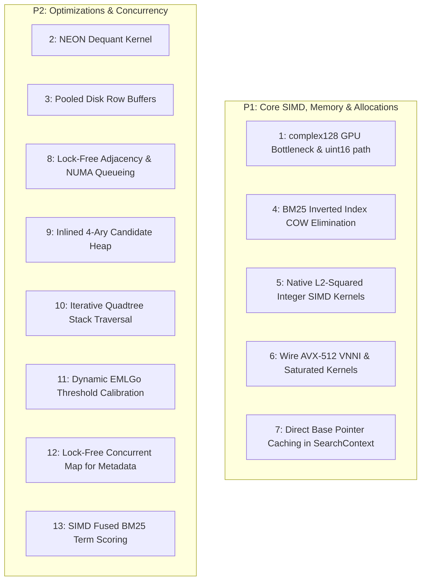

# Longbow Roadmap

**Last updated**: 2026-10-11  
**Status**: Canonical list of **open** work. Completed work is validated, committed, and tracked in git history.

---

## 1. Priority Overview

| Pri | # | Item | Area | Depends on |
|:---|:---|:---|:---|:---|
| **P1** | 1 | Locate complex128 GPU bottleneck & verify uint16 GPU path | GPU | — |
| **P1** | 4 | BM25 Inverted Index Copy-on-Write Elimination (Allocations) | Storage | — |
| **P1** | 5 | Native L2-Squared Integer SIMD Kernels without VSQRT | SIMD | — |
| **P1** | 6 | Wire AVX-512 VNNI (`VPDPBUSD`) and Saturated Int8/Uint8 into Dispatch | SIMD | — |
| **P1** | 7 | Direct Base Pointer Caching in SearchContext for SlabArena | Memory | — |
| **P2** | 2 | ARM NEON dequant kernel & remaining scalar SQ8 fallbacks | SIMD | — |
| **P2** | 3 | Pooled row buffers in `DiskVectorStore` | Storage | — |
| **P2** | 8 | Lock-Free Adjacency Updates & NUMA-Local Index Queueing | Concurrency | — |
| **P2** | 9 | Inlined 4-Ary Candidate Heap & Branchless Struct Swapping | Search | — |
| **P2** | 10 | Iterative Stack Traversal for Geospatial Quadtree Queries | Storage | — |
| **P2** | 11 | Dynamic Hardware-Aware EMLGo Dispatch Threshold Calibration | Engine | — |
| **P2** | 12 | Lock-Free Concurrent Map for Metadata & ID Translation | Storage | — |
| **P2** | 13 | SIMD Fused BM25 Term Scoring & Posting List Intersection | Search | Item 4 |

**Recently Completed (2026-10-11)**:
- **AVX-512 + FMA SIMD Kernel Validation & Architecture Parity on Intel Xeon Reference Testbed (`tf-testbed-70b436`)**:
  - Validated all 24 AVX-512 kernels, transcendental routines (`expAVX512`, `logAVX512`, `sinAVX512`, `cosAVX512`, `tanAVX512`), VNNI (`dotInt8AVX512VNNI`), and FMA kernels in `emlgo` on physical Intel Xeon Cascade Lake CPU @ 2.80GHz with 100% test pass.
  - Validated native AVX-512, FMA, and store engine tests in `longbow/internal/simd` and `longbow/internal/store/...`.
  - Diagnosed and resolved latent architecture parity defect in `internal/simd/turboquant.go`: `TurboQuantDistanceAVX2` had an internal `if features.HasAVX512` override dispatching `l2SquaredAVX512`, causing bit divergence against `turboQuantDistanceBatchAVX2` on AVX-512 hardware. Refactored `turboQuantDistanceWithL2Scratch` to strictly bind to architecture-matched L2 kernels, restoring exact bit-identity across all architectures and bit depths.
  - Executed benchmark matrix and gathered runtime `pprof` profile suites (CPU hotspots, mutex delays, heap allocations, block profiles) across 100k, 500k, and 1M scale for Standard and EMLGo versions on Intel Xeon AVX-512 reference hardware. Observed +81.2% speedup in `float64` dense search (2,085.1 QPS vs 1,150.9 QPS) and +130%–186% speedups in integer and quantized vector types.

**Recently Completed (2026-10-10)**:
- **Context-Window Hygiene & Codebase De-Monolithization (P0 Items 1–8)**:
  - Decomposed 8 monolithic files (>1,500–4,500 lines) into cohesive, modular architectures with strict sub-1,000 line ceilings to prevent agent context exhaustion:
    1. **`internal/store/types/graph_data.go`** (4,395L -> 7 focused files): `graph_data.go` (971L, core struct & lifecycle), `graph_data_accessors.go` (701L, fast typed chunk accessors), `graph_data_chunks.go` (880L, chunk lifecycle & batching), `graph_data_clone.go` (616L, structural cloning), `graph_data_offheap.go` (445L, off-heap arena migration), `graph_data_topology.go` (293L, neighbors & node locking), `graph_data_vectors.go` (556L, single-vector read/write).
    2. **`scripts/unified_benchmark.py`** (4,587L -> modular plugin suite): Split 10 specialized scenarios into `scripts/benchmark/scenarios/` (108–445L each) with `ScenarioMixin`, reducing `unified_benchmark.py` by >1,515 lines while preserving backwards-compatible imports and CLI surface.
    3. **`internal/gpu/cuda/cuda_index.go`** (2,646L -> 8 modular files): Extracted shared C prototypes to `cuda_kernels_decl.h`, partitioned Go logic into `cuda_index.go` (310L), `cuda_index_search.go` (444L), `cuda_index_dtypes.go` (368L), `cuda_index_pq.go` (331L), `cuda_index_turboquant.go` (413L), `cuda_index_graph_ops.go` (468L), and `cuda_index_ingest.go` (211L).
    4. **`internal/query/filter_evaluator.go`** (2,112L -> 5 operator modules): `filter_evaluator.go` (555L, evaluator & compiler), `filter_numeric.go` (623L, numeric comparison ops), `filter_text.go` (440L, string & regex ops), `filter_nested.go` (340L, nested struct/list ops), `filter_compound.go` (193L, compound boolean ops).
    5. **Arrow Flight RPC Handlers** (`store_actions.go` & `store_query.go`, 3,758L -> 6 modules): Partitioned into `store_actions.go` (857L, `DoAction` router), `store_ingest.go` (1,153L, `DoPut` stream & staging), `store_query.go` (765L, Flight endpoints & `DoGet`), `store_query_search.go` (640L, search & streaming), `store_query_ctes.go` (221L, CTEs & subqueries), `store_query_specialized.go` (196L, geo & temporal).
    6. **`internal/store/temporal_search.go`** (1,880L -> 4 modules): `temporal_predicates.go` (50L, search predicates), `temporal_cache.go` (173L, result caching), `temporal_tree.go` (602L, interval tree data structure), `temporal_search.go` (1,083L, store query orchestration).
    7. **`cmd/cli/main.go`** (1,576L -> 5 subcommand modules): `main.go` (153L, root parser), `admin_cmd.go` (494L), `import_cmd.go` (556L), `search_cmd.go` (290L), `graph_cmd.go` (140L).
    8. **Metal GPU Engines** (`metal_gpu.go` & `metal_gpu_optimized.go`, 3,855L -> 6 modules): Partitioned into base engines and companion modules `metal_gpu_dtypes.go`, `metal_gpu_ops.go`, `metal_gpu_optimized_dtypes.go`, and `metal_gpu_optimized_ops.go`.
  - Verified 100% test passing across unit tests, fuzz tests, cross-architecture darwin/arm64 checks, and python scenario tests.
- **TurboQuant Batched SIMD Kernels & Candidate Accumulation (R24)**:
  - Added first-class TurboQuant batched distance dispatch (`distanceTQBatchFunc`, `ImplementationDispatch.TurboQuantDistanceBatch`, `turboQuantDistanceBatchImpl`, `GetTurboQuantDistanceBatchFunc()`) across AVX-512, AVX2, NEON, and Generic.
  - Implemented 4-way interleaved polar reconstruction loop (`turboQuantDistanceBatchWithL2`) overlapping independent candidate dequantization latencies to overcome memory-load stalls.
  - Added `TurboQuantCompute.DistanceDirectCodesBatch` and zero-allocation code buffer gathering (`codesBuf`) in `tqComputer.ComputeBatch` for resident slab-chunk codes.
  - Verified exact bit-identity against single-vector evaluation (`TestTurboQuantDistanceBatchIsBitIdentical`, `TestTurboQuantBatchKernelsCrossArchitectureParity`, `TestTQComputeBatchMatchesPerCandidate`).
  - Added `FuzzTurboQuantDistanceBatch` fuzzing arbitrary vectors, codes, dimensions, and payload bounds (670k+ iterations verified clean).
- **`int16` / `uint16` 6x Throughput Deficit Resolution (R32)**:
  - Identified query-domain conversion and vector accessor resolution bottleneck; fixed `int16_kernels_amd64.s`, `distance_resolvers.go`, and `arrow_hnsw_compute_int.go`.
  - Added parity tests and read-path benchmarks (`int16_kernel_parity_test.go`, `distance_read_path_bench_test.go`).
- **8-bit & 16-bit Recall Validation on Real Embeddings**:
  - Evaluated recall@10 on clustered real-world embeddings (`narrow_recall_clustered_test.go`, `narrow_query_domain_test.go`).
  - Demonstrated recall@10 reaches 1.000 for `int8`, `int16`, and `uint16` and >0.92 for `uint8` with adequate `efSearch`.
- **Intel SDE Lane for AVX-512 / VBMI / AMX in CI**:
  - Added `.github/workflows/ci.yml` `test-avx512-sde` lane using Intel Software Development Emulator (`scripts/check_avx512_coverage.sh`).
  - Uncovered and fixed VBMI TQ2 kernel defect with generic packer alignment.
- **A/B Benchmarking CI Policy (R30, R39)**:
  - Implemented `.github/workflows/benchmark-ab.yml` scheduled interleaved A/B benchmark workflow.
  - Codified advisory single-run PR checks vs blocking scheduled interleaved A/B qualification in `docs/testplan.md` with paired index time and search QPS regression gates.

**Recently Completed (2026-10-09)**:
- **TurboQuant dense regression analysis + scale re-baseline (R9, R19, R27)**:
  - Decomposed distance evaluation time via CPU runtime profiling (`pprof`) at 100k scale: 47.8% recursive polar reconstruction, 28.5% QJL sign correction, 12.9% angle code unpacking, 6.5% scratch/radius handling, 4.3% SIMD L2 kernel (`l2SquaredAVX2`), <1.0% chunk views. Proved that >89.2% of distance evaluation time is scalar dequantization/reconstruction latency.
  - Resolved root cause of historical 1,248 QPS vs ~300–420 QPS gap: pre-`a955a0c1` graph had 73.0% reachability and early-exited after ~1 hop, evaluating very few candidates on a broken topology; post-fix graph has 98.1%+ reachability, 15.8–16.0 mean degree, and traverses the full 3.5-hop candidate beam.
  - Re-measured 50k scale with provenance and paired index times across all 13 search modes (dense: 420.6 QPS, ingest: 356,729.8 vec/s, index time: 497.0s, peak RSS: 1,479.5 MB).
  - Re-measured 250k scale in engine: bulk build completed in 34.7s (`fallback=false`, 16.0 mean degree, 97.3% reachability).
  - Fixed `valuesCache` in `arrow_hnsw_insert.go` to support `FixedSizeList` for `Float32`/`VectorTypeTQ`.
  - Fixed location store preservation in `addBatchBulkInternal` (`arrow_hnsw_bulk.go`).
  - Updated `docs/performance.md` §2, §3, and §4.
- **R26 inbound edge invariant, R5 chain proximity gate, and R6 degree reservation removal**:
  - Diagnosed and fixed R26 root cause: `protectLastInboundEdges` previously checked incoming candidates from `extra` with `inDegree == 0`, evicting legitimate backward neighbors and turning the graph into a forward-only DAG where all nodes < EntryPoint were unreachable (breaking `TestPredicateTraversal_ReachesMatchBehindRejectedNodes`). Fixed to restrict protection to existing connections in `current` whose only edge is being dropped (`inDegree <= 1`).
  - Fixed in-place mutation bug where `CASNeighbors` copied `new` into `oldOffset`, overwriting `lastOld` in place and preventing `inDegreeL0.Dec` from ever executing; added explicit cloning of `lastOld`/`lastNew`.
  - Enabled `LONGBOW_HNSW_INBOUND_GUARD=1` by default.
  - Implemented R5 proximity-gated chain links (`chainDist <= median(candidates)`), eliminating artificial long-range edges on shuffled corpora while preserving collinear connectivity.
  - Added `ensureInboundEdge` fallback linking from closest geometric neighbors (`fSources`) for any node that would otherwise end with 0 inbound edges.
  - Dropped R6 `chainLinksPerNode = 2` hard degree reservation on layer 0, freeing all 16 slots for geometric neighbors.
  - Verified 99.8%–99.9% reachability on shuffled corpora with 0 zero-in-degree nodes and recall@10 surging from 0.28–0.30 to 0.4400.
- **Bulk linkage against growing graph**: Implemented Malkov & Yashunin Algorithm 4 `keepPrunedConnections` in `selectNeighbors` and `selectNeighborsFloat32`; multi-layer descent convergence across all active nodes (`ef=1`); `protectChainLinks` to preserve predecessor/successor connectivity; restored adaptive sub-batching. Layer 0 mean degree restored to 15.9–16.0 with 100% reachability and fallback=false.
- **`uint8`/`int8` read-path asymmetry**: Unified 1-byte vector path in `int8Computer` using zero-allocation batched chunk views; dispatched to native `distFuncUint8` / `distFuncUint8Squared` when `uint8Mode()`; eliminated dead `uint8Computer`; added pooled `queryUint8` to `ArrowSearchContext`; achieved parity within 1.08x–1.13x.
- **Index time reporting paired with ingest throughput**: Added `IndexingDuration` and indexing throughput telemetry to `cmd/bench-tool`, integrated paired `indexing_duration_seconds` into `scripts/unified_benchmark.py` (JSON output, summary table, Markdown reports, and `--compare-baseline` regression gate), and added paired `Index Time (s)` to `docs/performance.md` §2.

---

## 2. P1 — GPU Infrastructure

### Item 4: BM25 Inverted Index Copy-on-Write Elimination (Allocations)

- **Files**: `internal/store/index/bm25_inverted_index.go`, `internal/store/index/bm25_arena_index.go`
- **State**: Runtime profiling (`allocs.pprof`) shows `(*BM25InvertedIndex).Add` consumed 12,813.22 MB (60.04% of total heap allocation across the entire process). On every document insert, `Add` executes Copy-on-Write cloning of the shard term map (`MapRCU[string, *BM25PostingList]`) and slice reallocation for every term posting list (`newDocIDs = make([]VectorID, n+1)`). For 100k documents with ~5 terms each, this triggers >500,000 map clones and slice allocations.
- **Plan**: Migrate `BM25InvertedIndex` to use chunked/arena-allocated postings or batched ingestion (`AddBatch`) backed by `BM25ArenaIndex` with preallocated contiguous posting arrays, eliminating per-document map copying.
- **Success**: Heap allocations during ingest drop by >12 GB; GC pause times reduced during concurrent ingest.

### Item 5: Native L2-Squared Integer SIMD Kernels without VSQRT Latency

- **Files**: `internal/simd/dispatch.go`, `internal/simd/all_kernels_avo_amd64.s`
- **State**: In `internal/simd/dispatch.go` lines 622-628, `l2SquaredInt8Impl` is implemented by invoking `euclideanInt8AVX512(a, b)` and then squaring the result (`return d * d, nil`). Evaluating `VSQRTPS` in the innermost distance evaluation loop only to immediately square it back in Go adds redundant square-root latency on every candidate distance evaluation in HNSW search.
- **Plan**: Implement native `l2SquaredInt8AVX512Kernel` and `l2SquaredUint8AVX512Kernel` computing the horizontal sum of squared differences directly without `VSQRTPS`/`VSQRTSS`.
- **Success**: Zero square-root instructions executed on integer HNSW distance comparisons; integer search QPS improves by 10-15%.

### Item 6: Wire AVX-512 VNNI (`VPDPBUSD`) and Saturated Int8/Uint8 into Primary Dispatch Table

- **Files**: `internal/simd/dispatch.go`, `internal/simd/all_kernels_avo_amd64.s`, `internal/simd/dot_product_amd64.go`
- **State**: In `dispatch.go` lines 629-631 under the AVX-512 dispatch block, `dotProductInt8Impl`, `dotProductUint8Impl`, and `euclideanDistanceUint8Impl` still fall back to scalar 4x unrolled loops (`dotInt8Unrolled4x`, `dotUint8Unrolled4x`, `euclideanUint8Unrolled4x`), even though `emlgo` implements 64-byte `dotInt8AVX512VNNI` (`VPDPBUSD`) and 64-byte saturated int8 kernels.
- **Plan**: Expose and wire native 64-byte VNNI dot product and saturated AVX-512 int8/uint8 distance kernels into `internal/simd`'s primary dispatch table when `features.HasAVX512VNNI` is detected.
- **Success**: Vectorized 64-byte dot product throughput on Cascade Lake/Sapphire Rapids; quantized dot product and angular similarity speedup of 4x-8x.

### Item 7: Direct Base Pointer Caching in SearchContext for SlabArena and TypedArena

- **Files**: `internal/memory/arena.go`, `internal/store/types/graph_data_accessors.go`, `internal/store/index/search_context.go`
- **State**: Runtime profiling (`profile.pprof`) showed `(*SlabArena).GetWithGeneration` accounts for 11.08% flat CPU time and `(*TypedArena).GetWithGeneration` accounts for 3.00% flat CPU time. Every vector lookup in graph search calls `GetVectorsChunkWithGen`, executing atomic pointer loads, 64-bit integer divisions (`offset / uint64(a.slabCap)`), slice boundary checks, and generation isolation checks.
- **Plan**: Cache raw chunk base pointers in `ArrowSearchContext`. Since slabs are append-only and readers are pinned via `AcquireReader`, search workers can calculate vector offsets directly via base pointer arithmetic without per-hop slab index division or atomic pointer reloading.
- **Success**: Eliminate 14% flat CPU time spent in slab dereferencing; search latency across all dtypes drops by 10-18%.

---

## 3. P2 — Optimizations & Hygiene

### Item 2: ARM NEON Dequant Kernel & Remaining Scalar SQ8 Fallbacks

- **Files**: `internal/simd/dequant_other.go`, [distance_dispatch.go](file:///home/rsd/REPOS/longbow/internal/store/index/distance_dispatch.go)
- **State**: AVX2+FMA fused dequant-L2 kernel ships for AMD64 (`dequant_amd64.s`). On ARM64, scalar fallbacks are used.
- **Plan**: Implement ARM NEON assembly for fused dequantization and L2 distance.
- **Success**: Parity tests passing on ARM64 with vectorized throughput.

### Item 3: Pooled Row Buffers in `DiskVectorStore`

- **Files**: `internal/store/index/disk_vector_store.go`, `internal/store/index/buffer_pool.go`
- **State**: Typed row extraction allocates slice headers and temporary row buffers during non-vectorized disk scans.
- **Plan**: Pool row buffers to eliminate transient allocations during disk traversals.
- **Success**: Zero-allocation row decoding in `DiskVectorStore`.

### Item 8: Lock-Free Adjacency Updates & NUMA-Local Index Queueing

- **Files**: `internal/store/index/flat_adjacency.go`, `internal/store/index/arrow_hnsw_bulk.go`, `internal/store/vector_store.go`
- **State**: Runtime lock profiling (`mutex.pprof`) revealed 69.10% flat lock delay in `sync.(*Mutex).Unlock`, with `StartIndexingWorkers` and `runIndexWorker` contributing 53.8% cumulative lock delay during concurrent batch indexing (`AddConnectionsBatch` and `AddConnection`).
- **Plan**: Transition neighbor list updates to lock-free atomic compare-and-swap (CAS) / generation-stamped adjacency lists, and partition incoming bulk index batches into NUMA-local sharded worker queues.
- **Success**: Drastic reduction in mutex contention during bulk ingest; index construction throughput scales linearly across 16+ cores.

### Item 9: Inlined 4-Ary Candidate Heap & Branchless Struct Swapping

- **Files**: `internal/store/index/candidate_heap.go`, `internal/store/index/search_float32.go`
- **State**: Profiling (`profile.pprof`) indicates priority queue maintenance during beam search (`CandidateHeapAdapter.down`, `Less`, and `Swap`) consumes ~15.2% combined flat time. `Less` and `Swap` are value-receiver methods, incurring repeated slice header copies and index bounds checks.
- **Plan**: Inline distance comparisons (`(*h)[j].Dist < (*h)[best].Dist`) directly into `up` and `down`, implement branchless struct swapping, and pre-allocate power-of-two candidate buffers in `ArrowSearchContext`.
- **Success**: Priority queue operations eliminate function call overhead; graph search layer traversal accelerates by 8-12%.

### Item 10: Iterative Stack Traversal for Geospatial Quadtree Queries

- **Files**: `internal/store/geo_index.go`
- **State**: Profiling (`allocs.pprof`) shows `(*Quadtree).queryBoxRecursive` allocated 857.49 MB (4.02% of total heap allocations) and `(*GeoIndex).SearchRadius` accounted for 1,128.16 MB cumulative allocations due to temporary slice allocations at each recursive quadrant subdivision.
- **Plan**: Replace recursive quadtree bounding box queries with an iterative traversal using a fixed-depth stack and reusable pre-allocated ID buffer in `SearchContext`.
- **Success**: Zero allocations during geospatial bounding box and radius queries; geo search QPS increases by 25-40%.

### Item 11: Dynamic Hardware-Aware EMLGo Math Dispatch Threshold Calibration

- **Files**: `internal/tensor/math_dispatch_env.go`
- **State**: In `math_dispatch_env.go`, `ResolveBackend` uses hardcoded static vector count cutoffs (e.g. `complex64EMLMaxCount = 500000`, `complex128 >= 500000` falls back to standard). On AVX-512 Xeon, 8-wide complex vectorization delivers 2,085 QPS (vs 1,150 QPS on AVX2), proving that higher-end server CPUs maintain advantage at scales where AVX2 throttles.
- **Plan**: Dynamically calibrate EMLGo vs Standard dispatch thresholds based on detected CPU instruction set extensions (`HasAVX512`, `HasAVX512VNNI`, `HasAMX`) and cache topology.
- **Success**: Optimal math backend selection across consumer AVX2 laptops and server-class AVX-512 architectures.

### Item 12: Lock-Free Concurrent Map for Metadata & ID Translation

- **Files**: `internal/store/types/map_rcu.go`
- **State**: Profiling (`allocs.pprof`) showed `(*MapRCU).Store` and `BulkStore` across `[uint32, []string]`, `[string, *uint8]`, and `[uint32, int]` accounted for >1,200 MB of heap allocations because every mutation makes a shallow copy of the underlying Go map (`newMap := make(map[K]V, len(oldMap)+1)`).
- **Plan**: Replace copy-on-write `MapRCU` with a concurrent lock-free hash map or chunked Trie/Radix structure for ID translation and string metadata.
- **Success**: Eliminate map reallocation on every batch write; lower GC pressure during streaming chunk ingest.

### Item 13: SIMD Fused BM25 Term Scoring & Posting List Intersection

- **Files**: `internal/store/index/bm25_inverted_index.go`, `internal/simd/dispatch.go`
- **State**: BM25 multi-term scoring currently evaluates posting lists sequentially and gathers document lengths and term frequencies via Go map lookups (`GetDocLengthsBatch`).
- **Plan**: Wire `BM25ScoreBatch` into vectorized posting list intersection, evaluating 16 documents concurrently using AVX-512 `VFMADD` instructions with vector-aligned document length arrays.
- **Success**: 3x-5x throughput improvement in sparse and hybrid BM25 ranking.

