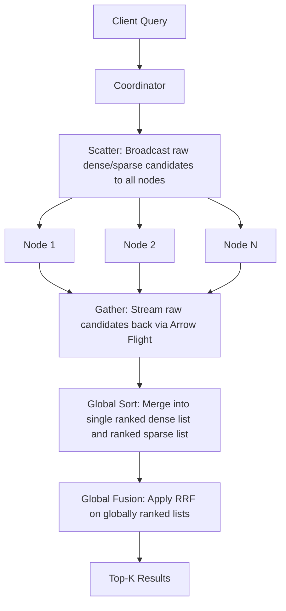

# Unified Search & Discovery Guide

**Last Updated**: 2026-11-13

Longbow provides an integrated suite of search modalities across Apache Arrow Flight (`DoGet` / `DoAction`), REST v1 (`/api/v1/*`), GraphQL (`/api/v1/graphql`), `longbow-cli`, and the Python SDK (`LongbowClient`).

## Search Modes Overview

| Mode | Description | Flight / REST Endpoint | Python SDK |
|------|-------------|------------------------|------------|
| **Dense (ANN / k-NN)** | HNSW vector similarity (`float32`..`complex128`) | `{"search": ...}` / `POST /datasets/{name}/search` | `client.search()` |
| **ByID** | O(1) lookup & neighbor search from a stored ID | `{"search_by_id": ...}` / `POST .../search/by-id` | `client.search_by_id()` / `search_by_id_df()` |
| **Filtered** | Metadata predicates (`filters`), `filter_expr` AST, CTEs | `{"search": {"filters": ...}}` / `POST .../search` | `client.search(filters=...)` |
| **Sparse (BM25)** | Inverted keyword retrieval (`alpha=0.0` + `text_query`) | `{"search": {"alpha": 0.0, ...}}` | `client.search(text_query=..., alpha=0.0)` |
| **Advanced Full-Text** | Boolean AST (`AND`/`OR`/`NOT`), phrase, fuzzy `~N`, facets | `AdvancedTextSearch` / `POST .../text-search` | `client.advanced_text_search()` / `search_facets()` |
| **Hybrid** | Dense + BM25 RRF/weighted fusion (+ `raw_hybrid`) | `{"search": ...}` / `POST .../hybrid` | `client.search(text_query=..., alpha=0.5)` |
| **Range Search** | All vectors within a distance threshold bound | `{"range_search": ...}` / `POST .../range-search` | `client.range_search()` |
| **Temporal** | `as_of`, `range`, `sliding_window`, `sliding_window_time` | `{"temporal_search": ...}` / `POST .../temporal-search` | `client.temporal_search()` |
| **Geo-Spatial** | Haversine `radius`, `box`, and geo+vector `hybrid` | `{"geo_search": ...}` / `POST .../geo-search` | `client.geo_search()` |
| **Multi-Modal** | Cross-modal text, PNG/JPEG image, PCM16 WAV audio | `MultiModalSearch` / `POST .../multimodal-search` | `client.multimodal_search()` |
| **Recommend** | Hybrid vector + multi-hop graph seed expansion | `{"recommend": ...}` / `POST .../recommend` | `client.recommend()` |
| **GraphRAG / GlobalGraphRAG** | Spreading activation & cluster-wide graph expansion | `graph_alpha > 0` / `traverse-graph` / `GraphRAGExpand` | `client.search(graph_alpha=...)` / `traverse()` |
| **Federated** | Cross-collection / tag-routed RRF parallel search | `{"federated_search": ...}` / `POST /api/v1/search/federated` | `client.federated_search()` |
| **TurboQuant** | 2/4/8-bit compressed vector ANN search | `vector_type: "turboquant"` | `vector_type="turboquant"` |
| **Learned Index** | Runtime k-NN index dispatch (`enable_learned_index`) | `"enable_learned_index": true` | Auto-enabled (`LONGBOW_LEARNED_INDEX_ENABLED`) |
| **Global Distributed** | Cluster scatter-gather + Global RRF fusion | `LocalOnly: false` / `x-longbow-global: true` | Automatic when cluster peers active |

---

## 1. Dense Search (Vector Similarity)

HNSW-based vector similarity with sub-millisecond latency.

### Python SDK

```python
from longbow import LongbowClient

client = LongbowClient(uri="grpc://localhost:3000")
client.connect()

# Basic vector search
results = client.search(
    dataset="documents",
    vector=[0.1, 0.2, 0.3, ...],  # Query vector
    k=10  # Return top 10
)
# Returns DataFrame with: id, text, distance columns
```

### Supported Metrics

| Metric | Formula | Best For |
| :--- | :--- | :--- |
| **Euclidean (L2)** | `√(Σ(a[i] - b[i])²)` | Image search |
| **Cosine Distance** | `1.0 - (dot(a,b) / (\|\|a\|\|*\|\|b\|\|))` | Text embeddings |
| **Dot Product** | `-(Σ(a[i] * b[i]))` | MIPS, recommendations |

### IVF-OPQ Composite Index

For billion-scale datasets:

```python
client.create_namespace(
    name="billion_scale",
    dims=768,
    data_type="opq",      # Optimized Product Quantization
    nlist=1024,          # IVF clusters
    nprobe=64            # Clusters to search
)
```

---

## 2. Sparse Search (BM25)

Full-text keyword retrieval using an inverted BM25 index (configured via `LONGBOW_HYBRID_TEXT_COLUMNS`, e.g. `text,category`).

**Algorithm**: BM25 with configurable $k_1$ and $b$ parameters (tunable per dataset via `TuneBM25`, `POST /api/v1/datasets/{name}/bm25/tune`, or `longbow-cli tune-bm25`).

**Engine Optimizations**:

- **Precomputed Block-Max WAND Bounds (`BM25InvertedIndex`)**: `BM25PostingList` caches per-block `(BlockMaxTF, BlockMinLen)` metadata during `Add`/`Delete` so `BlockMaxWANDSearch` skips non-competitive blocks in O(1) without rescanning posting slices.
- **Off-Heap Arena & SIMD Scoring (`BM25ArenaIndex`)**: Stores document IDs and `float32` term frequencies in paired off-heap `ArenaSlab` buffers (`docArena` and `postingArena`) and evaluates batch BM25 scores via `simd.BM25ScoreBatch`.

**Use Case**: Exact keyword matching where semantic embeddings might be too "fuzzy".

```bash
longbow-cli search -uri grpc://127.0.0.1:3000 -dataset documents -mode sparse -text "arrow flight" -k 10
```

```python
results = client.search(
    dataset="documents",
    text_query="arrow flight",
    alpha=0.0,  # Pure sparse BM25 (no query vector required)
    k=10,
)
```

---

## 3. Hybrid Search (RRF & Alpha Blending)

Combines Dense and Sparse retrieval via Reciprocal Rank Fusion or weighted alpha blending.

### Reciprocal Rank Fusion (RRF)

RRF is a rank aggregation algorithm that combines multiple ranked result lists into a single unified relevance ranking without requiring score normalization. Because dense vector similarity scores (e.g., Cosine, L2) and sparse scores (e.g., BM25) operate on completely different numerical scales, direct score-based merging is unstable. RRF solves this by ignoring raw scores entirely and focusing purely on the relative rank positions of documents.

The RRF score for a document $d$ is calculated as:

$$RRF\_Score(d) = \sum_{m \in M} \frac{1}{RRF\_Constant + Rank_m(d)}$$

Where:

- $M$: The set of input ranking models (e.g., dense and sparse).
- $Rank_m(d)$: The 1-based index position of document $d$ in the output of model $m$. If a document does not appear in a list, its rank score for that model is 0.
- $RRF\_Constant$: A smoothing constant (traditionally denoted as $k$, defaulting to `60` in Longbow) that prevents highly-ranked documents from completely dominating while smoothing the penalization of lower ranks.

### Alpha Blending

```python
results = client.search(
    dataset="documents",
    vector=[0.1, 0.2, ...],
    text_query="search terms",  # Combine with BM25
    alpha=0.7,  # 1.0 = dense, 0.0 = sparse
    k=10
)
```

### WASM / ONNX Integration Pipeline

Longbow's Unified ML Inference Engine allows developers to embed lightweight transformer models (e.g., embedding and sparse keyword generators) directly into the database nodes via pure-Go WebAssembly (`wazero`).

#### In-Process Ingestion and Search Pipeline

1. **WASM Embedding**: Download a model (e.g., `all-MiniLM-L6-v2`) to a database node using the administrative command:

   ```bash
   longbow-cli download-model -repo sentence-transformers/all-MiniLM-L6-v2 -dest models/all-mini
   ```

2. **Dense and Sparse Inference**: The in-process WASM/ONNX runtime executes the model to generate:

   - A **Dense vector** (e.g., 384-dimensional float array).
   - A **Sparse bag-of-words vector** (e.g., SPLADE token allocations or BM25 query terms).

3. **Execution**: Both vectors are submitted to `hybrid_search.go`, performing HNSW graph traversal and inverted index block-max WAND matching simultaneously.

4. **RRF Aggregation**: The results are instantly fused using `ReciprocalRankFusion` before being returned to the client.

### CLI Usage

Perform hybrid search using RRF by choosing `hybrid` search mode. Use `-alpha` to configure how heavily dense or sparse should influence candidates, and `-text` for the textual query:

```bash
longbow-cli search \
  -uri grpc://127.0.0.1:3000 \
  -dataset product-catalog \
  -mode hybrid \
  -vector 0.12,0.43,-0.05 \
  -text "wireless noise cancelling headphones" \
  -alpha 0.5 \
  -k 10
```

### Python SDK Usage

The Python SDK handles zero-copy Arrow-backed retrieval and maps the request to the distributed RRF fusion coordinator:

```python
from longbow import LongbowClient

client = LongbowClient("grpc://127.0.0.1:3000")
client.connect()

results_df = client.search(
    dataset="product-catalog",
    vector=[0.12, 0.43, -0.05, ...],  # Dense vector
    text_query="wireless noise cancelling headphones",  # Sparse text query
    alpha=0.5,  # Balance parameter (0=sparse, 1=dense)
    k=10
)

# results_df is a Pandas DataFrame ordered by fused RRF scores
print(results_df[["id", "score"]])
```

### Use Cases

- **E-Commerce Search**: Combines exact product name matching (sparse keyword) with semantic user intent (dense vector), ensuring exact-phrase matches (e.g., SKU numbers) do not get lost in semantic clustering.
- **Enterprise Q&A (RAG)**: Integrates exact acronyms, department names, or code functions (sparse) with natural language questions (dense) to supply highly relevant context to LLM prompts.
- **Cross-Lingual Search**: Uses dense joint spaces for semantic translation alignment alongside sparse dictionary indices to boost exact terms that match across languages.

---

## 4. Filtered Search

Metadata filtering by result-set gating: the predicate is evaluated as the traversal expands, but it never prunes the frontier. Every candidate the HNSW walk reaches is pushed onto the search heap unconditionally, and the predicate (plus the metadata filter and the tombstone check) is only applied when a candidate is admitted to the result set. A node that matches the predicate is frequently reachable only through nodes that do not match it, so gating the frontier strands those matches; the traversal source documents this in `internal/store/index/search_float32.go`, with the same shape in `search_float64.go` and `distance_dispatch.go`.

The practical consequence is that a filtered query costs about the same as an unfiltered one over the same subgraph, and its recall against an exact scan of the admitted IDs improved from 0.06 to 0.38 when the frontier was left open (`internal/store/index/predicate_traversal_test.go` pins the >= 0.25 floor). A rejected node is still counted for observability as `longbow_hnsw_nodes_skipped_total`, but it stays in the graph.

```python
results = client.search(
    dataset="documents",
    vector=[0.1, 0.2, ...],
    filters=[
        {"field": "category", "operator": "==", "value": "tech"},
        {"field": "priority", "operator": ">=", "value": "5"},
    ],
    k=10
)
```

**Operators**: `==` / `eq`, `!=` / `neq`, `>` / `gt`, `>=` / `gte`, `<` / `lt`, `<=` / `lte`, `in`, `contains` / `like` (plus boolean `filter_expr` AST groups with `AND`, `OR`, `NOT`).

---

## 5. ByID Search

O(1) instant lookup and nearest-neighbor retrieval for stored vector IDs.

```python
# Find neighbors of a stored vector (returns dict or DataFrame)
neighbors = client.search_by_id(
    dataset="documents",
    id="12345",
    k=10,
)
neighbors_df = client.search_by_id_df(
    dataset="documents",
    id="12345",
    k=10,
)

# Fetch the stored vector/record by ID
record = client.get_vector(
    dataset="documents",
    id="12345",
)
```

---

## 6. Temporal Search (Time-Travel)

Versioned discovery via snapshots.

```python
# As-Of search (state at specific time)
results = client.temporal_search(
    dataset="documents",
    search_type="as_of",
    timestamp=1700050000000000000,  # Unix nanoseconds
    k=10
)

# Range search (time window)
results = client.temporal_search(
    dataset="documents",
    search_type="range",
    start_time=1700000000000000000,
    end_time=1700100000000000000,
    k=10
)

# Sliding window (last N items)
results = client.temporal_search(
    dataset="documents",
    search_type="sliding_window",
    window_size=100,
    k=10
)

# Sliding window by duration
results = client.temporal_search(
    dataset="documents",
    search_type="sliding_window_time",
    duration="1h",  # "30m", "2h", "1d"
    k=10
)

# Version history
versions = client.temporal_version_history(
    dataset="documents",
    vector_id=12345
)
```

---

## 7. Geo-Spatial Search

Location-aware search using the Quadtree index. A linear Morton/Z-order grid is also available for write-heavy datasets by setting `IndexType: "morton"`; it inserts ~2.3x faster with no per-insert node allocation, but its fixed cell resolution makes queries 17-40% slower, so `quadtree` is the default.

```python
# Radius search (Haversine distance)
results = client.geo_search(
    dataset="locations",
    center={"lat": 37.7749, "lon": -122.4194},
    radius_km=10,
    search_type="radius",
    k=10
)

# Bounding box search
results = client.geo_search(
    dataset="locations",
    box={"min_lat": 37.7, "max_lat": 37.8, "min_lon": -122.5, "max_lon": -122.4},
    search_type="box",
    k=10
)

# Hybrid (vector + geo)
results = client.geo_search(
    dataset="locations",
    center={"lat": 37.7749, "lon": -122.4194},
    radius_km=5,
    query_vector=[0.1, 0.2, ...],  # Combine with semantic search
    search_type="hybrid",
    k=10
)
```

---

## 8. GraphRAG (Knowledge Graph)

Dual-path: Spreading Activation + Knowledge Graph triples.

### Spreading Activation

```python
# Hybrid search with graph re-ranking
results = client.search(
    dataset="documents",
    vector=[0.1, 0.2, ...],
    graph_alpha=0.7,  # Graph weight (1.0 = full graph, 0.0 = pure vector)
    graph_depth=2,    # Graph traversal depth
    k=10
)
```

### Knowledge Graph

```python
# Add edges
client.add_edge(
    dataset="knowledge",
    subject=1,
    predicate="knows",
    object=2,
    weight=1.0
)

# Recommend (hybrid vector-graph)
results = client.recommend(
    dataset="documents",
    seed_ids=["doc_1", "doc_2"],
    alpha=0.5,  # Balance vector vs graph
    max_hops=2,
    k=10
)

# Traverse graph
results = client.traverse(
    dataset="knowledge",
    start=1,
    max_hops=2,
    decay=0.5
)

# PageRank centrality
scores = client.calculate_pagerank(dataset="knowledge")

# Community detection
communities = client.detect_communities(dataset="knowledge")
```

---

## 9. TurboQuant Search (Compressed)

Two-stage vector compression (PolarQuant + QJL sign correction) achieving roughly 2.5x-4.7x storage reduction at the usable bit depths.

### Usage

```python
# Create TurboQuant dataset
client.create_namespace(
    name="compressed",
    dims=768,
    data_type="turboquant",  # or "tq"
    turboquant_bits=4       # 4 or 8; 1-3 encode but do not round-trip
)

# Search works the same
results = client.search(
    dataset="compressed",
    vector=[0.1, 0.2, ...],
    k=10
)
```

### Compression Ratios

Compression is fixed by `PackedSize(dims, bits)` in `internal/store/index/turboquant.go`: 4 bytes of radius, `(pow2-1)` angles packed at `bits` each, `pow2` QJL sign bits, rounded up to 32 bytes, where `pow2` is the next power of two at or above `dims`.

| Bits | Ratio (768D) | Round-trip cosine | Typical Use |
|------|--------------|--------------------|-------------|
| 1-3-bit | 5.7x-10.7x | 0.00-0.82 (unusable) | Not supported for retrieval |
| 4-bit | 4.6x | 0.92-0.95 | Standard |
| 8-bit | 2.6x | ~0.995 | High recall |

The encoder accepts 1-8 bits, but `TestTurboQuantRoundTrip` only pins a cosine floor above 0.90 for 4-8 bits, and the measured round-trip at 2-3 bits falls well below it. The large ratios at those depths are not a usable trade: the reconstructed direction no longer retrieves.

---

## 10. Learned Index (Adaptive)

Automatic index selection using k-NN classifier.

### Feature Vector

13-dimensional features including:

- `DatasetSize` (Most discriminating)
- `QueryComplexity`
- `AvgVectorNorm`
- `IsFiltered` / `IsHybrid`

### Auto-Dispatch

System learns optimal weights over time via Fisher Linear Discriminant (LDA).

---

## 11. Global Distributed Search (Cluster-Wide)

Scatter-gather search across multiple Longbow nodes.

### Distributed Global Reciprocal Rank Fusion

In a distributed, sharded search architecture, traditional RRF exhibits a major regression: **local rank skew**. If each cluster node executes dense and sparse searches on its own local shard and applies RRF locally, the local ranks are highly distorted because the node only has visibility into a fraction of the corpus. When the coordinator attempts to merge these pre-fused lists, the aggregate rank is mathematically incorrect.

Longbow solves this by implementing **Global Reciprocal Rank Fusion** inside `global_search.go`:

1. **Raw Scatter**: The coordinator scatters the hybrid search request to all cluster nodes, requesting un-fused raw dense and sparse candidates.
2. **Global Gather**: All raw candidate lists are streamed back to the coordinator using zero-copy Arrow Flight streams.
3. **Global Sort**: The coordinator aggregates all dense candidates into a single global dense list, and all sparse candidates into a single global sparse list, sorting each by score to establish a true global rank.
4. **Global Fusion**: The coordinator executes the RRF calculation on these globally ranked lists.

   ```go
   finalResults = ReciprocalRankFusion(req.Dataset, allDense, allSparse, 60, req.K, nil)
   ```

### Distributed RRF Flow



### Python SDK (Global Distributed)

```python
# Automatic global search when peer nodes available
results = client.search(
    dataset="documents",
    vector=[0.1, 0.2, ...],
    k=10
    # If cluster peers exist, automatically scatter-gathers
)
```

### Global IDs

Each vector has a global ID across the cluster:

- **GlobalID**: Unique across all nodes (node_id << 32 | local_id)
- **LocalID**: Unique within single node

### Request Options

```python
# Force local-only search (skip scatter-gather)
results = client.search(
    dataset="documents",
    vector=[0.1, 0.2, ...],
    k=10,
    local_only=True  # Skip cluster peers
)

# Specify specific nodes
results = client.search(
    dataset="documents",
    vector=[0.1, 0.2, ...],
    k=10,
    nodes=["node-1", "node-2"]  # Specific peers only
)
```

### Cluster Metrics (Prometheus)

| Metric | Description |
|--------|-------------|
| `longbow_global_search_fanout_size` | Peers contacted per search |
| `longbow_global_search_partial_failures_total` | Failed peer queries |
| `longbow_global_search_duration_seconds` | Scatter-gather latency |
| `longbow_gossip_active_members` | Healthy cluster nodes |
| `longbow_global_rrf_latency_seconds` | Latency of global reciprocal rank fusion |
| `longbow_global_rrf_payload_bytes` | Payload elements passed to global RRF |

### CLI Benchmark

```bash
# Benchmark distributed search
python3 scripts/unified_benchmark.py \
    --mode cluster \
    --dims 768 \
    --counts 10000 \
    --peers 3
```

---

## 12. Distance-Threshold Range Search

Returns all vectors within a Euclidean/similarity `threshold` distance bound from the query vector (with optional metadata filters and `max_results` cap). Supported over Flight `DoGet` (`{"range_search": ...}`), `DoAction` (`RangeSearch`), REST `POST /api/v1/datasets/{name}/range-search`, GraphQL `rangeSearch`, `longbow-cli range-search`, and Python SDK `range_search()` / `rest_range_search()`.

```bash
longbow-cli range-search -uri grpc://127.0.0.1:3000 -dataset documents -vector 0.1,0.2,0.3 -threshold 0.5 -k 100
```

```python
matches = client.range_search(
    dataset="documents",
    vector=[0.1, 0.2, 0.3],
    threshold=0.5,
    max_results=100,
)
```

---

## 13. Advanced Full-Text Search & Facets

Provides Boolean AST (`AND`/`OR`/`NOT`), exact `"phrase"` matching, Damerau-Levenshtein fuzzy terms (`term~1`), `<mark>` highlighted snippets, categorical facets, per-dataset BM25 (`k1`, `b`) tuning, and query/zero-result analytics. Supported via `AdvancedTextSearch` / `SearchFacets` / `SearchAnalytics` / `TuneBM25` Flight actions, REST `POST /api/v1/datasets/{name}/text-search`, GraphQL `textSearch`, `longbow-cli text-search`, and Python SDK `advanced_text_search()`.

```bash
longbow-cli text-search -uri grpc://127.0.0.1:3000 -dataset documents -query 'arrow AND "flight"~1' -facets category -k 10
```

```python
resp = client.advanced_text_search(
    dataset="documents",
    query='arrow AND "flight"',
    fuzzy_max_dist=1,
    facet_fields=["category"],
    k=10,
)
```

---

## 14. Multi-Modal / Cross-Modal Search

Embeds and searches text, PNG/JPEG images, and PCM16 WAV audio into a shared joint vector space (configurable local spatial/spectral embedder or remote MLBackend HTTP/ONNX embedder). Supported via `MultiModalIngest` / `MultiModalIngestParquet` / `MultiModalSearch` Flight actions, REST `POST /api/v1/datasets/{name}/multimodal-search`, GraphQL `multimodalSearch`, `longbow-cli multimodal-search`, and Python SDK `ingest_media()` / `multimodal_search()`.

```bash
longbow-cli multimodal-search -uri grpc://127.0.0.1:3000 -dataset media_ds -modality image -text "sunset beach" -k 5
```

```python
client.ingest_media("media_ds", [{"id": "img1", "modality": "image", "mime_type": "image/png", "caption": "sunset", "blob": png_bytes}])
hits = client.multimodal_search("media_ds", text_query="sunset beach", modality="image", k=5)
```

---

## 15. Federated Cross-Collection Search

Executes parallel k-NN search across multiple collections or tag-matched collections registered in the federated router and merges results via Reciprocal Rank Fusion (`rrf_k`). Automatically synchronizes active live datasets into the router. Supported via Flight `DoGet` (`{"federated_search": ...}`), `DoAction` (`FederatedSearch`, `ListFederatedCollections`, `RegisterFederatedCollection`), REST `POST /api/v1/search/federated` & `/api/v1/federated/collections`, GraphQL `federatedSearch`, `longbow-cli federated-search`, and Python SDK `federated_search()`.

```bash
longbow-cli federated-search -uri grpc://127.0.0.1:3000 -collections docs_v1,docs_v2 -vector 0.1,0.2,0.3 -k 10 -rrf-k 60
```

```python
client.register_federated_collection("docs_v1", tags=["prod", "kb"])
fused_df = client.federated_search(vector=[0.1, 0.2, 0.3], tags=["prod"], k=10, rrf_k=60)
```

---

## 16. Companion Pipeline Actions (Reranking, Query Rewriting, Explainability & Provenance)

Longbow provides pipeline stages around every search query across Flight `DoAction`, REST v1, GraphQL, CLI, and Python SDK:

- **Reranking & Offline Evaluation (`Rerank`, `EvaluateReranker`)**: Re-scores candidates using `heuristic`, `cross_encoder`, `llm_api` (OpenAI / Cohere `/v1/rerank`), `mmr`, or `hybrid` strategies with LRU/TTL caching (`POST /api/v1/rerank`, `POST /api/v1/rerank/evaluate`, `longbow-cli rerank`, `longbow-cli eval-reranker`, `client.rerank()`, `client.evaluate_reranker()`).
- **Query Rewriting (`RewriteQuery`)**: Expands queries using `synonyms`, `multi_query`, or `hyde` hypotheses (`POST /api/v1/query/rewrite`, `longbow-cli rewrite-query`, `client.rewrite_query()`).
- **Explainability, Cost Planner & Hop Trace (`ExplainSearch`, `DebugSearchPath`, `ExplainQueryPlan`)**: Inspects dense/sparse/RRF/graph score attribution, visited HNSW graph hops, and cost-based query plans (`POST /api/v1/search/explain`, `POST /api/v1/search/debug`, `POST /api/v1/planner/explain`, `longbow-cli explain-search`, `longbow-cli explain-plan`, `client.explain_search()`, `client.debug_search_path()`, `client.plot_search_explanation()`).
- **Vector Provenance (`RecordProvenance`, `GetProvenance`)**: Tracks source document, chunk index, embedding model, and pipeline version per vector (`POST /api/v1/provenance`, `GET /api/v1/datasets/{name}/provenance/{id}`, `longbow-cli record-provenance`, `longbow-cli get-provenance`, `client.record_provenance()`, `client.get_provenance()`).

---

## 17. Resilience & Observability

### Circuit Breaker

- **Trip Conditions**: 10 consecutive failures
- **Cooldown**: 30-second reset

### Prometheus Metrics (`LONGBOW_METRICS_ADDR`)

| Metric | Description |
|--------|-------------|
| `longbow_search_requests_total` | Throughput per mode |
| `longbow_search_latency_seconds` | Latency P50/P95/P99 |
| `longbow_vector_search_latency_seconds` | Search latency histogram |
| `longbow_turboquant_search_total` | TurboQuant search count |
| `longbow_learned_index_adaptations_total` | Adaptive index switches |

### Benchmark

```bash
# Run full benchmark matrix across all search modes
python3 scripts/unified_benchmark.py \
    --mode cpu \
    --dims 768 \
    --counts 10000 \
    --search-modes all

# Run dedicated specialized search scenarios
python3 scripts/unified_benchmark.py \
    --mode temporal,geo,range,federated,text,multimodal,recommend,graphrag,learned_index \
    --dims 128 \
    --counts 1000

# Run bench-tool directly across all 21 search modes
./bin/bench-tool -uri 127.0.0.1:3000 -dim 128 -scale 10000 -search-modes all -queries 200 -workers 8
```

> [!NOTE]
> For complete GraphRAG documentation, see [graphrag.md](graphrag.md).
